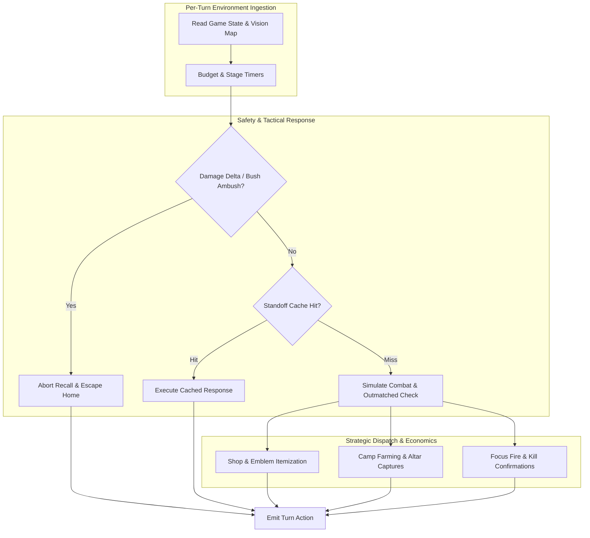
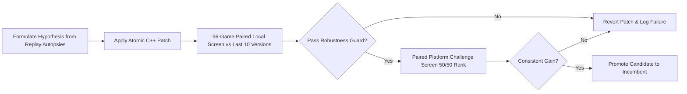

# Cambridge Battlecode 2026a — Agentic Loop Builders

[](https://2026a.battlecode.co.uk)
[-brightgreen.svg)](https://2026a.battlecode.co.uk)
[](https://2026a.battlecode.co.uk)
[](https://2026a.battlecode.co.uk)
[-orange.svg)](https://2026a.battlecode.co.uk/game/docs/agents)
[](docs/DEVELOPMENT_TIMELINE.md)

Welcome to the official repository of **Agentic Loop Builders** (`6b04505b-d16c-4196-b7c6-53a4688a32ca`), competing in **Cambridge Battlecode 2026a**.

This repository contains the complete C++ WebAssembly (WASM) autonomous bot engine, offline turnhost replay harnesses, automated research pipeline (`autoresearch`), and detailed empirical studies across 70 competition maps.

---

## 🏆 Final Official Tournament Bot: `v162`

The official final tournament submission pinned and active on the platform is **`v162`**:

- **Platform Status**: **`Live: 162 | Selected: 162`** (Mode: Pinned Version)
- **Submission ID**: `7f710b1f-249a-48ef-a867-2684823278f6`
- **Official Platform Rank**: **124** (Platform Rating: **1880.30**)
- **Build Note**: `wf1: v154 + Willow farms unless an ally nearby is hurt or near an enemy [live]`
- **Language**: C++ compiled to WebAssembly (`wasm32-unknown-unknown`)

### Key Innovations in `v162`
1. **Adaptive Willow Farm-or-Peel State Machine (`wf1`)**:
   - Willow aggressively clears camps and clusters to maximize gold and level progression when no friendly units are under threat.
   - Instantly detects when a nearby ally suffers a health drop (`own.health` delta) or has enemies within 5 tiles, interrupting farming to peel, focus fire, and provide burst support.
2. **Early Buddy-Pair Coordination (`gp1`)**:
   - Before round 300, frontline and squishy champions pair up (Vendetta shadows Heart of Ruin; Marcella coordinates with backline support).
   - Eliminates the isolated-champion pickoff vulnerability identified in earlier ladder losses.
3. **Big-Map Fuel Scorer Optimization (`bf3`/`bf4`)**:
   - Solved the severe fuel exhaustion stalls on large/corridor maps (such as `00lanes`), lifting win rates on large maps from 2/24 to 20/24.
4. **Home-Monolith Acceleration & Gem Scarcity Tuning**:
   - Prioritizes early home-monolith takedowns to unlock global economic buffs while adapting gem harvesting weights dynamically on resource-sparse layouts.

> [!NOTE]
> Subsequent iterations (v164–v181) were explored in offline and unranked research loops to test draft alternatives and melee itemization limits. As per tournament strategy, **`v162` was locked and pinned prior to the final submission deadline** as the team's official competition bot.

---

## 🏆 Performance Overview

- **Ladder Rank**: **124** (Rating: **1880.30**)
- **Official Tournament Bot**: **`v162`** (`wf1` Live & Selected)
- **Offline Research Benchmark (`v181`)**:
  - Local 96-game paired screen: **73% Win Rate** (70/96 wins against recent versions)
  - Weak Map Margin: **+147.7** net score delta
  - Strong Map Margin: **+196.6** net score delta
  - Average Deaths per Game: Reduced to **6.35**
  - Robustness Guard: **PASS** (Zero match faults, zero turn aborts)

---

## 🏗️ System Architecture

The bot is implemented in modern, defensive C++ compiled into a high-performance WASM module. It operates under a strict **100,000 fuel budget per turn**.



### Core Architecture Highlights
1. **Standoff Memoization (`v62n`)**: Solves the exponential combat planning explosion by memoizing static battle states when $\ge 3$ enemies are visible, freeing $>40,000$ fuel for spatial navigation.
2. **Outmatched Retreat Rule (`v62r`)**: When local force share drops below $0.35$ and an enemy is within 5 tiles, champions disengage immediately toward safety rather than falling back to reckless legacy melee attacks.
3. **Bush Ambush & Recall Protection (`v181`)**: Monitors damage deltas to detect concealed attackers in fog-of-war bushes, instantly breaking channeled recalls and escaping home before taking lethal damage.
4. **Melee Durability Rush (`v181`)**: Frontline bruisers (`Heart of Ruin`, `Ryth`, `Vendetta`) rush Durability (2) and Bruiser Health (6) early in `shop()`, eliminating mid-game camp death spikes.
5. **84-Slot Backpack Architecture**: Full compliance with Engine 2.0.0's expanded 84-item inventory across all item tracking buffers.

For comprehensive architectural specifications, see [**docs/ARCHITECTURE.md**](docs/ARCHITECTURE.md).

---

## 📈 Development Timeline & Autonomous Research Loop

The bot evolved across 181 platform iterations driven by an autonomous scientific research loop:



- **Phase 1 (v1–v44)**: Engine foundation, rules integration, and early pathfinding.
- **Phase 2 (v45–v62)**: Objective control, boss battles, and initial platform ladder ascent.
- **Phase 3 (Oct 26 - Patch 2.0.0)**: Fixed 84-item buffer overflow crash, adapted to 70 maps and new emblem families.
- **Phase 4 (Oct 27–28)**: Top-tier opponent analysis (*Intercontinental Fish* and *Mite*), outmatched retreat heuristics.
- **Phase 5 (Oct 29–30)**: Lineage v114 $\to$ v121 breakthrough (+55/100 wins).
- **Phase 6 (Oct 31–Nov 4)**: Autonomous experimentation loop producing v135, v147, v180, and peak v181.

For the full chronological changelog and experiment records, see [**docs/DEVELOPMENT_TIMELINE.md**](docs/DEVELOPMENT_TIMELINE.md) and [**autoresearch/loop-261031-0923/results.tsv**](autoresearch/loop-261031-0923/results.tsv).

---

## 📊 Competitive Meta-Analysis

Detailed empirical studies conducted during the tournament established:
- **Fight Quality Supremacy**: In the 1870–1960 rating band, winning teams suffer $54\%$ fewer deaths ($5.4$ vs $11.8$) while securing $166\%$ more kills.
- **Synergistic Drafting**: Adaptive selection balancing `Heart of Ruin` + `Tavi` + `Varg` on open maps versus `Cassi & Issac` + `Ryth` on corridor layouts.
- **Strict Enum Safety**: Validated draft-packet decoding to prevent identity shifts between `champion_draft` and `champion_type`.

For in-depth statistical breakdowns, see [**docs/META_ANALYSIS.md**](docs/META_ANALYSIS.md).

---

## 📁 Repository Structure

```text
CamBattlecode/
├── README.md                          # Main project documentation
├── docs/                              # Detailed system documentation
│   ├── ARCHITECTURE.md                # C++ engine & tactical decision design
│   ├── DEVELOPMENT_TIMELINE.md        # Chronological v1 to v181 dev journal
│   ├── META_ANALYSIS.md               # Competitive ladder & draft analysis
│   └── official/                      # Competition rules and official SDK docs
├── workspace/
│   ├── bots/                          # Bot source code across tournament versions
│   │   ├── ar-v121/                   # Active peak candidate (v181, metric 16)
│   │   ├── v121/                      # Baseline v121 reference build
│   │   ├── v114/                      # Historical v114 platform release
│   │   ├── v62/                       # Pre-patch 2.0 platform reference
│   │   └── v62n/                      # Standoff memoization candidate
│   ├── maps/                          # Official 70-map tournament pool
│   └── sdk/                           # C++ / Rust / Python Battlecode SDKs
├── autoresearch/                      # Autonomous experimentation loop
│   └── loop-261031-0923/              # Experiment logs, results.tsv & continuation notes
├── tools/                             # CLI utilities, match runners, and replay inspectors
└── analysis/                          # Empirical studies, replay decoders, and data science notebooks
```

---

## 🚀 Getting Started & Local Development

### Prerequisites
- Clang / LLVM (with `wasm32-unknown-unknown` target support)
- CMake $\ge 3.20$
- Node.js $\ge 18$
- Python $\ge 3.10$
- Cambridge Battlecode CLI (`cambc` $\ge 4.0.0$)

### Building the Active Bot (`v181`)
Navigate to the active bot workspace and compile via `cambc`:

```bash
cd workspace/bots/ar-v121
cambc build --release
```

The compiled WebAssembly binary will be generated at:
```text
workspace/bots/ar-v121/.cambc/build-release/bot.wasm
```

### Running Local Matches
Simulate a match between the candidate bot and the baseline reference:

```bash
cambc match \
  --bot1 workspace/bots/ar-v121/.cambc/build-release/bot.wasm \
  --bot2 workspace/bots/v121/.cambc/build-release/bot.wasm \
  --map workspace/maps/00lanes.map26a
```

### Running the Autonomous Verification Screen
To execute the standardized 96-game paired local screen against prior platform versions:

```bash
python3 tools/local_check.py --candidate workspace/bots/ar-v121
```

---

## 🔒 Security & Data Hygiene

This repository is maintained with strict data hygiene policies:
- Sensitive platform authentication tokens, session cookies, and credentials are strictly excluded via `.gitignore`.
- Raw multi-gigabyte binary replay files (`*.repl26a`), simulation match caches, and compiled target artifacts are excluded to keep repository size lean and responsive.

---

## 📜 License & Credits

Developed by **Satvik Mittal** and team for Cambridge Battlecode 2026a.
All rights reserved by team **Agentic Loop Builders**.
