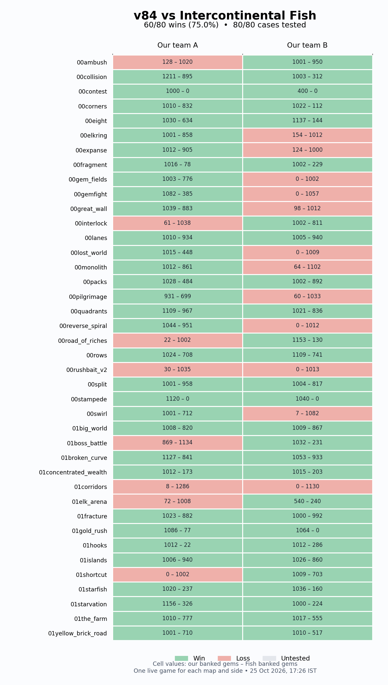

# Fish-specific counter — v84

**60/80 live wins (75%)**, tested once on **all 40 published maps from both sides**. Wins on **38/40 maps**; both sides won on **22/40 maps**. Team A: **32/40**; Team B: **28/40**. This exceeds the requested total win rate of 60% and succeeds on 95% of maps in at least one side configuration.

Submission **v84**, ID `7d0e0c5c-2634-4b6d-bfb8-7e9a13ccd9c0`, bot **fish-atlas-09**. Submission note: **TARGET: Intercontinental Fish | atlas09 | 40-map / both-side overfit counter**.

The result applies to the live Fish behaviour tested on 25 October 2026. Twenty exact map/side cases still lose. The two maps with no win are **00rushbait_v2** and **01corridors**. This is an intentionally overfitted trajectory library; a different Fish policy, map revision, or changed starting conditions can invalidate a reference.

Native replay validation: **80/80 completed**, 0 errors. Full uploaded source verification: **114/114 files byte-identical** to the tested source.

## Complete live result

Each cell is a new live game against Intercontinental Fish. The same v84 submission is bound to all 16 challenge sets; no v83 results are folded into the rate. The first three sets yielded 11/15 wins; thirteen further sets yielded 49/65. No convenient map/side repeats replace missing cells.

All 60 wins exactly reproduce their selected reference’s banked scores and finishing round. Three wins finish by the round-2000 score comparison instead of reaching 1000 gems: `00contest/b` 400–0, `00pilgrimage/a` 931–699 and `01elk_arena/b` 540–240. Mean banked-score margin over all eighty games: **+101.675**.

Evidence: [evaluation JSON](evaluation_v84.json), [first 15 results](trials/atlas09/result.json), [remaining 65 results](trials/atlas09_rest/result.json), [per-map table](catalogue/LIVE_RESULTS.md). Individual challenge receipts and API responses are retained in each trial folder.

## What the bot does

The bot identifies a map/side from public static map dimensions, camp-group count and our spawn region. It selects the corresponding draft and replays a complete winning trajectory: movement, attacks, ability slots, item purchases and sales, priority changes, wards, recall/cancellation, teleport crystals, locks and tributes. Live entity targets are resolved through legal personal-vision APIs. The library contains **756,520 retained actions** in fixed-size records, with direct indexed decoding for the current champion and round. The source ZIP is **2,732,293 bytes**, below the platform’s 5 MB limit.

This reproduces observed counterplay. It does not recover another team’s source code or its full general decision procedure. Unsupported cases or play beyond the recorded horizon use the inherited v77 reactive fallback, whose performance is not established as a Fish counter.

## Reusable counterplay schema

The [human-readable catalogue](catalogue/README.md) and [structured counterplay JSON](catalogue/counterplay.json) contain **80 cases** and **470 explained sequence segments**. The [visible-state dataset](catalogue/observations) contains **7076 examples**, obtained from the observing champion’s personal-vision API at selected opening, fight and banking rounds.

Each case records source replay/team/time, engine patch, exact map/side, required draft/order, selection reasons and alternatives, the observed Fish draft/behaviour, round-bounded move sequences, intended mechanisms, conditions and uncertainties, plus actual v84 validation. State examples are labelled as a validated positive trajectory or a rejected trajectory for current Fish. A recorded source win is never silently equated with a new live success.

Useful components: [strategy patterns](catalogue/STRATEGY_PATTERNS.md), [source selection](selected.json), [complete action/state books](books), [v83 diagnostic comparisons](trials/atlas08/diagnosis.json), [versioned evaluation history](case_evaluation_history.json). Earlier explanations and references are archived in [revisions/atlas08](revisions/atlas08).

## What the failed iteration taught us

v83 won **4/15** on the same initial fifteen map/side cases; v84 won **11/15**. The principal corrections were:

- **Reference compatibility:** recent unranked wins sometimes contained a different Fish draft or opening from current play. Revision 2 prioritizes ranked references compatible with current ranked/live draft evidence, while keeping verified current wins. A matching draft alone is insufficient to establish an unchanged entire policy.
- **Exact item-sale identity:** selling one emblem is different from selling five shards. The corrected encoder preserves the actual sold item. On the three retained failing trajectories, the first state differences were at rounds 605, 1209 and 866, immediately after erroneous sales at 604, 1208 and 865. All three now win.
- **Spawn bounds:** engine spawn rectangles have exclusive maximum coordinates. The offline decoder now queries both teams’ official regions and converts the bounds correctly; the prior reflected bounds broke Team-B map recognition.
- **Evidence separation:** partial opening fidelity and local functional wins are not live win-rate evidence. Source references, uploaded bot versions and new challenge results are kept separate.

Seven cases had no winning reference with the inferred current Fish draft in the available corpus and were explicitly marked provisional: `00elkring/b`, `00gem_fields/b`, `00lost_world/b`, `00monolith/b`, `00pilgrimage/b`, `01corridors/a`, `01corridors/b`. Their current failure remains visible in the matrix. The other losses also remain listed; none are hidden by resampling.

## Reproduction and immutable source

- [Complete uploaded source ZIP](trials/atlas09/submitted_source.zip).
- [Byte verification and hashes](trials/atlas09/source_verification.json).
- [Frozen submitted source](trials/atlas09/submitted_source/src).
- Local source: `../../workspace/bots/fish-atlas-09/src/`.
- Build from `workspace/`: `../.venv/bin/cambc build fish-atlas-09 --release`.
- [Candidate manifest](fish-atlas-09_manifest.json), [initial test plan](initial_plan.json), [remaining test plan](remaining_plan.json), [full eighty-case matrix](full_matrix.json).
- Native replay bundles and decoded metrics live under `trials/atlas09` and `trials/atlas09_rest`.

The HTTP workflow uses terminal scripts and the official CLI. No browser automation or opponent-private source was used. Relevant capture, channel, priority, item and Prism mechanics were reread from the current canonical rules. Current documentation assets and champion definitions had previously been checked against the active front-end bundle; all selected and tested games use the same full engine patch ID.

## Next authorized stages

User-requested order: **Fish → Mite → Claudus Maximus → Trzy Kwaterki → Willow Best Girl**. Each later target must have a separate bot, target-specific submission note, its own counterplay catalogue and a complete map/side win-rate evaluation above 60%. Do not start the next target before the preceding target meets its objective. Fish’s numeric and near-complete-map targets are reached by this result; native validation is the final verification step before advancing.
