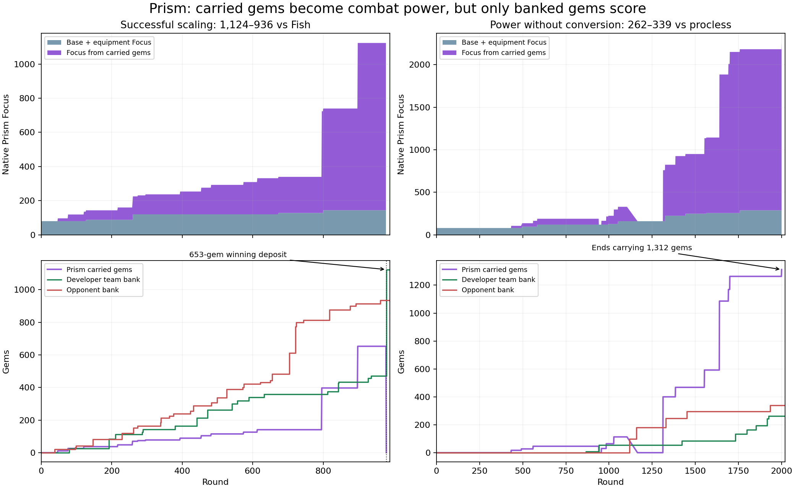

# Does the developer's Prism team reveal an overlooked strategy?

Yes: the evidence supports a successful specialist Prism strategy, and the published balance notes explicitly encourage one. It does not establish that selecting Prism alone improves any existing bot, or that every team should select Prism on every map.

## Verified facts and scope

The [live ladder](https://2026a.battlecode.co.uk/game/ladder) snapshot at **23 October 2026, 21:22:46 IST** identifies the team as **prism best girl**, with bio **prism is actually good**, team ID `38e6d8c4-1608-44f5-956b-08390f564336`. Its rank is 1, rating approximately 2263, and the public `isDev` flag is true. These facts support the user's identification of an organizer-side developer team; they do not establish the author's intention behind the name.

Its published champion statistics show Prism in **50/50** sampled drafts. Independently, I fetched its ten latest completed ranked sets: **50 individual games, with Prism in all 50**, and 31 game wins. The developer team won nine of those ten sets, with its latest set a 1–4 loss to procless. These are different denominators: set wins are not game wins.

For detailed behavioral analysis I decoded all games in the seven newest of those sets: **35 games, seven opponents, 23 maps, 21 wins and 14 losses**. That required **7,349,919 native engine steps**. Native winners, scores and final rounds agreed with match metadata for every replay. This recent strong-opponent sample is not an estimate of the team's lifetime or future ladder win rate. Remote submission versions are hidden, so this is a recent behavioral sample rather than a source-version-isolated experiment.

All website access used terminal HTTP scripts. No bots were changed, uploaded or activated, and no matches were fired. This analysis is separate from the earlier frozen v58 report.

## The hint is unusually explicit

[Patch 1.0.2](https://2026a.battlecode.co.uk/game/patch-notes/e251fa42-fb2a-4d9b-ab8c-2e044f21d599) increased Prism's passive from 1 to **1.5 Focus per carried gem**. The accompanying text says the organizers wanted to “encourage teams to build a specialist strategy around them.”

The earlier 1.0.0 changes had already increased the passive from 0.2 to 1, while reducing equipment stat growth. The stated design direction was a high-risk mage whose power comes from gems. Across those changes, Focus per gem rose 7.5-fold from the older 0.2 value. At the same time, 1.0.2 reduced several competing burst champions' output.

The patch feed, current champion-grid asset and handbook asset were refetched at **21:25:18 IST** and matched the previously reviewed official sources byte for byte. See [freshness verification](docs_check/verification.json). The native replay engine is `v1_0_3`; the latest published balance note is 1.0.2. Those labels alone do not imply an additional undocumented balance change.

Thus the strongest evidence of an intended specialist strategy is the published patch text. The developer team's name and strong results reinforce that interpretation, but do not prove an intentional tutorial or a universally dominant champion.

## Why Prism changes the economy

The current [champion specifications](https://2026a.battlecode.co.uk/game/docs/champions) give Prism:

- Base Focus 80; 8 more per matching ordinary Focus shard.
- An extra 1.5 Focus for each gem currently carried.
- Slot 0: 1.5 × Focus damage and a one-round stun, range 4.
- Slot 1: 1 × Focus damage in a radius-one area, cast-center range 4.
- Eight-owner-turn-end cooldown per slot, one successful cast per turn, and spells that exclude walking.

These are raw damage values before mitigation, shields, camp bonuses and overkill:

| Carried gems | Focus with no equipment | Slot 0 damage | Slot 1 damage per affected target |
|---:|---:|---:|---:|
| 0 | 80 | 120 | 80 |
| 50 | 155 | 232.5 | 155 |
| 100 | 230 | 345 | 230 |
| 200 | 380 | 570 | 380 |
| 400 | 680 | 1,020 | 680 |

One hundred carried gems supply 150 Focus: the same Focus as **18.75 ordinary Focus shards**, or 562.5 gold at 30 per shard. This is an equivalence of combat stats, not spendable gold; completed Power emblems have a different stat efficiency.

For most champions, carried gems are cargo to secure. For Prism they are also temporary combat capital. The potential feedback loop is: collect gems, gain spell power, clear valuable camps or win fights faster, then gain more gems. Banking secures score but immediately removes the passive Focus. Death also removes it.

This creates a real policy question that a generic bag threshold does not solve: **when is securing score worth giving up the damage that is producing our next resources?**

## What this bot actually does

### Survival receives much of the equipment budget

Prism bought items in 34 of the 35 games. In **32 of those 34**, its first purchase was Durability Health shards or a completed Durability Health emblem. Two games began with Monster Focus; one game had no purchases.

Where the game lasted long enough, the recurrent progression was:

**Durability Health → Monster Focus → Jungle Health → Home Health → further Bruiser Health/Focus investment.**

That is coherent with gem scaling: improve survival, reduce camp damage, improve recovery, and let the bag provide substantial damage. It is an observed build pattern, not proof that each item is individually optimal or should be copied into our controller.

### Large bags are retained and sometimes used to finish the game

Across 38,050 living Prism turn starts, native Focus readings exactly matched:

`80 + 8 × equipment Focus-shard equivalents + 1.5 × carried gems`

The maximum absolute residual was zero. The passive is producing the documented increase in actual games; the analysis does not need an undocumented Focus bonus to explain the observed values.

Prism's median per-game maximum bag was **133 gems**. In the 21 wins it was **259**; in the 14 losses, **72**. Strong games permit larger bags, and larger bags can improve strength, so these outcome-conditioned figures do not isolate causality.

Prism completed 23 deposits in 19 games. **Twelve deposits immediately brought the team to at least 1,000**, ending the match. Eleven others did not; this is not an absolute never-bank-before-winning rule. There were also interrupted or unfinished starts. In four wins Prism never completed a deposit, so allies can deliver the victory while Prism contributes elsewhere.

### This is not an all-resources-to-Prism funnel

Across the sample, Prism received **21.7%** of the team's captured camp gems, Vesper **38.1%**, and Marcella **20.8%**. Prism's mere presence does not mean every teammate hands over every reward. Camp receipts can reflect routes and opportunity rather than an explicit allocation instruction; the source is private.

Prism had a living ally within Chebyshev distance five in **70.2%** of sampled living turn starts. This is offline geometric proximity, not proof that the ally was providing protection, had the same vision or could intervene immediately.

## Two concrete examples

Top panels use actual native Focus at Prism turn starts, separated into equipment/base and gem-derived contributions. Bottom panels show carried gems and completed team deposits. The winning example includes the final state when the deposit completes; there is no subsequent live Prism turn after the match ends.

### A working loop against Fish

In [`00monolith` versus Intercontinental Fish](https://2026a.battlecode.co.uk/game/visualiser/3119447e-6249-4a86-8323-147176e60778), the developer team won **1,124–936**.

- Prism accumulated 653 gems.
- Its native Focus reached **1,123.5**: 144 base/equipment plus **979.5 from gems**.
- At round 904 a single-target cast removed **1,685.25 enemy HP**, exactly 1.5 × that Focus.
- Prism started a 653-gem tribute at round 913 and completed it at round 979.
- That deposit raised the team's score from 471 to 1,124 and ended the game.
- Prism had no deaths.

This is a concrete example of carrying meaningful power, surviving, and then converting it into a winning deposit. The [local replay](games/00monolith/3119447e-6249-4a86-8323-147176e60778.repl26a) is retained.

### A scaling failure and a conversion failure

Against Fish on [`00stampede`](https://2026a.battlecode.co.uk/game/visualiser/16db9ed8-405f-4a03-8471-a934479ae5d6), the developer team lost **0–1,120**. Prism died seven times and acquired zero camp gems. The feedback loop never got started. A powerful passive does not fix a failed opening.

Against procless on [`01boss_battle`](https://2026a.battlecode.co.uk/game/visualiser/9b6be73c-4254-4d39-9f4d-5d1dbe833b73), Prism ended with **1,312 carried gems**, had reached **2,256 Focus**, and the team still lost **262–339** at round 2,000. Earlier tribute attempts failed to convert those large bags into score. The final start, at round 1,901 with 1,263 gems, required 127 countdown ticks and could not finish before the round limit even without interruption.

This is the central constraint: **combat capital is only useful if it produces victory or can be converted in time**. Long channels, stuns, altar locks, deaths and travel all matter. Holding indefinitely is not a sound universal rule.

## The rest of the ladder is already mixed

Current published picks per 50 sampled team games:

| Rank | Team | Prism picks |
|---:|---|---:|
| 1 | prism best girl — developer | 50/50 |
| 2 | Intercontinental Fish | 0/50 |
| 3 | procless | 0/50 |
| 4 | policy wonk | 2/50 |
| 5 | Pantheon | 50/50 |
| 6 | :3 | 33/50 |
| 7 | Univardisty of Shingtonwash | 15/50 |

The developer team is therefore not the only strong Prism user. Strong teams also succeed without Prism. Published pick samples are recent windows, not every draft in each team's history, and rank differences do not measure the causal value of one champion.

## Implications for our v58

This comparison refers to the exact v58 snapshot reviewed earlier, not a fresh download of a potentially changed active upload.

- Its ordinary meta draft omits Prism; gate/boss paths can pick Prism. Adding Prism to ordinary maps is an untested roster change.
- Its ordinary tribute function uses general bag, distance, nearby-camp and score-deadline conditions, without an explicit Prism combat-capital valuation. It would not automatically reproduce the observed retention policy.
- Its `X_CARRYMODE=2` handoffs prioritize a poorer nearby ally, rather than evaluating how much an extra gem improves Prism's future contribution.
- With active `X_TBUILD`, ordinary builds use the generic ranged/Tung equipment plan. Selecting Prism would not automatically adopt the developer's observed defensive build.
- Current native Focus is already read by our executor and tactical model. We should not claim v58 is numerically blind to gem Focus; the strategic allocation and conversion policies are the missing distinction.

These observations identify a promising new strategy family to test. They do not establish a tested improvement to v58.

## Experiments that would answer the useful question

Use a fixed source baseline, common maps/opponents/sides and a separate holdout. Test components separately before combining them:

1. **Roster only:** replace one appropriate pick with Prism, preserving existing policy. This estimates whether the kit alone helps this controller.
2. **Equipment:** evaluate the observed survival-oriented opening independently. Preserve useful existing builds as controls.
3. **Gem retention:** add a Prism-specific, risk-aware decision about continued farming versus depositing. Include the lost spell power after banking and the full channel/travel time before the round limit.
4. **Capture allocation:** compare opportunistic Prism reward priority with current handoffs. Avoid waiting for a distant Prism or discarding Vesper's income advantage.
5. **Coordination and counters:** test protection, camp clearing, range-aware combat, early pressure on enemy Prism, ready-stun/lock threats during large channels, and profitable declines when Prism is already too strong.

Measure heavy-loss rate, early gem acquisition, Prism survival, useful damage, gem losses, completed deposits and final margins alongside wins. Do not tune only against this developer team or copy its observed thresholds without testing. The current analysis performed no candidate-bot matches.

## Evidence and reproducibility

- [Ladder snapshot](ladder.json), [target team](team.json), and [50 match metadata records](matches.json).
- [35 native replay bundles and index](games/index.json), with individual files under `games/`.
- [Native per-step aggregates and Prism turn observations](native.json), [readable summaries](summary.json).
- [Fresh documentation verification](docs_check/verification.json) and raw official patch/champion/handbook assets.
- `fetch.mjs`, `analyze.mjs`, `summarize.py`, and `plot.py` record the read-only collection and analysis.
- `images/prism_examples.png` and `.svg` are separate external image files.

Immediate HP-difference damage measurements exclude shields and are not a full accounting of delayed effects. Proximity is an offline descriptive measure. Public replays reveal behavior and outcomes, not the private objective function or proof of the author's intention.
