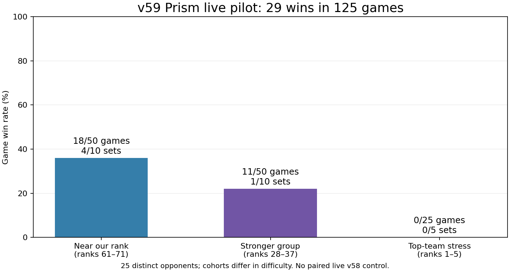

# Prism strategy experiment — v59

Updated: 2026-10-23T17:23:01.406280+00:00.

## Current platform state

Accepted upload: **v59**, `9cad0a59-0831-47dd-80c5-3deeeb2da945`. Last recorded build status: **inactive**. Source bot: `workspace/bots/prism-tempo`.

**The previous active v58 has been restored. v59 remains uploaded for further experiments.** The live pilot did not support replacing the previous default.

Uploaded source was verified byte for byte against the tested files before activation. See [submission verification](submission_result.json).

## What changed

The candidate branches from frozen v57, preserving its tested controller behavior rather than importing v58's regressing staged-bridge bundle. The active v58 was downloaded again and its source matched the earlier audit exactly. Existing teammate bot directories were not edited.

- Prism appears in the normal roster: Heart, Vesper, Prism, Marcella, Vendetta, as team size permits. This preserves frontline and reset-based camp clearing alongside the mage.
- Prism's equipment follows the observed survival-oriented idea: Durability Health, Monster Focus, Jungle Health, Home Health, then additional Bruiser Health/Focus.
- Captured gems have an extra discounted equipment value in Prism's task scorer, computed using native Focus shard growth. Gold-only target commitment no longer traps Prism in the same capital loop.
- Both of Prism's damage slots count in its long-run farming cycle estimate; they are still cast on separate legal turns.
- Healthy Prism can retain gem capital while productive tasks exist. A 160-gem banking trigger bounds retention; this is not a maximum bag size, since rewards and kills can overshoot it.
- Public team score, legally observed allied bags, enemy score, travel time and channel duration can force conversion earlier. A 40-round margin is reserved before the round limit.
- Nearby healthy Prism can receive a shared gem reward without waiting for a distant carry or diverting gold-only camps from Vesper.
- Prism receives bounded capture-wait recovery, earlier low-HP recovery with a valuable bag, and useful-area camp spell selection.

These policies are a tested adaptation of the observed strategy, not access to the developer team's private source or an exact reconstruction of its objective function. Fixed thresholds are experimental heuristics, not proven optimal constants.

## Local experiments and rejected variants

All runs use the official release engine, 100,000 C++ fuel and matched opponent/map/side inputs. Sources are hashed before and after each batch. Development used 20 maps; the first holdout used the other 20 maps and different opponents. Local opponents are frozen approximations or historical bots, not live remote teams.

| Phase | Subject | Games | Wins | Mean gem margin | Losses by 500+ | Bot faults |
|---|---|---:|---:|---:|---:|---:|
| development | prism-v58-control | 60 | 31 | +80.4 | 9 | 0 |
| development | prism-v57-control | 60 | 40 | +178.1 | 8 | 0 |
| development | prism-roster | 60 | 31 | +110.7 | 9 | 0 |
| development | prism-core | 60 | 27 | +50.3 | 12 | 0 |
| development | prism-front | 60 | 29 | +13.3 | 13 | 0 |
| refinement | prism-economy | 60 | 35 | +128.8 | 9 | 0 |
| refinement | prism-balanced | 60 | 35 | +159.9 | 8 | 0 |
| holdout | prism-v58-control | 60 | 48 | +550.4 | 3 | 0 |
| holdout | prism-v57-control | 60 | 48 | +519.9 | 6 | 0 |
| holdout | prism-balanced | 60 | 46 | +465.6 | 9 | 0 |
| tempo | prism-tempo | 60 | 37 | +119.8 | 12 | 0 |
| tempo | prism-fortress | 60 | 33 | +119.8 | 8 | 0 |
| validation | prism-v58-control | 120 | 103 | +473.2 | 4 | 0 |
| validation | prism-v57-control | 120 | 106 | +506.6 | 7 | 0 |
| validation | prism-tempo | 120 | 95 | +410.8 | 10 | 0 |

**1080 completed local games across these batches.** Every reported completed batch had zero candidate bot faults, no missing outcomes and no source changes.

The first full Prism bundle regressed (27/60), so it was rejected. The bounded-economy candidate improved development wins to 35/60, then failed its first holdout (46/60 versus both controls' 48/60). That rejection is preserved in `selection_first_holdout_failed.json`.

The selected Prism-tempo candidate achieved **37/60**, versus active-v58 control **31/60** and v57 control **40/60**, on the shared development contexts. Its heavy losses were worse (12 versus v58's 9). The additional `validation` batch, if shown above, uses three previously unused local opponents and all 40 maps; it was scheduled after the upload decision, not used to retune the uploaded source.

The user explicitly authorized evaluating live even if local performance is slightly worse. Accordingly, local superiority is not a deployment claim or a mandatory gate; correctness, source integrity and candid reporting remain required. The live experiment evaluates this exact frozen source.

## Live check

The plan is **25 challenges / 125 individual games against 25 distinct teams**: ten near our rank, ten near half our rank, and five top-team stress tests. No side-swapped repeat challenges against the same opponent are used. Maps and sides are balanced across the pool.

| Cohort | Opponent rank range at selection | Games won | Sets won | Mean gem margin | Heavy losses |
|---|---|---:|---:|---:|---:|
| near_our_rank | 61–71 | 18/50 | 4/10 | -155.4 | 17 |
| near_half_rank | 28–37 | 11/50 | 1/10 | -400.1 | 26 |
| top_stress | 1–5 | 0/25 | 0/5 | -708.6 | 18 |

Combined game wins: **29/125**. Cohorts deliberately differ in difficulty; the combined rate is not a random-ladder estimate.

## Replay findings

The Prism prototype did not demonstrate a viable replacement in this pilot: **29/125 game wins (23.2%)**, **5/25 set wins**, and **61 losses by at least 500 gems**. The two main cohorts account for 29/100 game wins and 5/20 sets; the top-five stress tests account for 0/25 games. Opponent difficulty is explicit in the cohort table; this is not a controlled estimate of the difference from v58.

All **125** replays were decoded and their scores, outcomes and final rounds checked against platform match metadata, across **25,204,646 native steps**. Prism was picked in all 125 games. The Focus formula matched native readings at all **126,689** living Prism turn starts.

### What worked mechanically

Prism received **21.3%** of our camp gems. Its spells gained the documented Focus, it completed captures and deposits, and the bot produced 29 wins. A successful gold-rush game against DOOMSDAY ended 825–473 at the round limit: Prism banked 440 gems across the game and reached 495.5 Focus. These observations establish working mechanics, not a successful overall policy.

### Why the losses remain serious

In the **61 heavy losses**, our team captured **293.7** camp gems on average versus **1021.2**, and had **22.4** deaths versus **4.2**. Prism averaged **6.0 deaths** and acquired only **83.3 camp gems**. Final carried gems across our surviving team averaged only **22.4**. Depositing the final bag sooner cannot recover most of the missing income in those games.

Across all 125 games, Prism had a living ally within five tiles at **47.0%** of its living turn starts. The earlier developer sample was 70.2%. These are offline proximity descriptions of different opponent/map samples, not proof of protection or an isolated causal effect. They motivate testing explicit coordinated clears and support.

### Direct comparison with the developer team

We lost all five games against `prism best girl`. Within these same five matches, our Prism averaged **143.6 captured camp gems, 82.6 banked gems and 2.0 deaths**; theirs averaged **349.6 captured camp gems, 349.0 banked gems and 0.2 deaths**. On `gem_fields`, the two Prisms captured **78 versus 753** gems, with **3 versus 0** deaths. On `islands`, our Prism banked 146 while theirs banked zero and their team still won: the rest of the team remains essential.

This is evidence that the applied strategy remains incomplete. The 160-gem trigger may constrain scaling in successful situations, but many heavy losses happen before a meaningful bag develops. Raising the trigger alone is not an established fix.

### Runtime findings

Native bot-error events: **0** across both teams. Caught API-error log games for our bot: **0**. The expected v59 build label appeared in all **125** bundles. There were **6** ordinary inputs at the 100,000-fuel limit across **694,515** ordinary inputs, and **6** logged suspensions. These were rare and recovered; they must not be reported as zero, or presumed to explain the strategic losses.

### Next experiments supported by this result

1. Coordinate Prism's early gem clears with an actual nearby helper and a feasible capture plan. The current upload does not implement a dedicated escort or shared assignment system.
2. Test survival and task selection together, including usable allied arrival time and visible ready burst/control. Avoid turning retreat into an unproductive permanent state.
3. Revisit retention only after the opening can produce and protect a bag. Compare adaptive survival/tempo-based retention with the current 160 trigger and the developer's larger bags.
4. Profile the rare camp-executor fuel overruns and preserve enough action reserve. Preserve the already working legality/frame guards.

These are proposed experiments, not fixes already applied to v59. No second Prism version was uploaded during this pilot.

## Interpretation limits

The old v58 platform sample and this pilot differ in opponents, maps, timing and hidden enemy versions. A higher or lower raw win percentage does not establish a causal improvement. Twenty-five opponent sets also do not provide 125 independent opponent strategies. Unranked matches do not directly change ladder rating.

This experiment does not implement every earlier v58 audit recommendation. It does not claim ML, RL, hidden-state access, or a complete opponent fingerprinting model. Some inherited routing and combat approximations remain.

## Evidence

- [Candidate selection and user steering](selection.json).
- [Source of the active v58 baseline](active_source_hashes.json).
- [Latest official balance check](rules_freshness.json).
- [Developer-team replay study](../prism_rank1_2026-10-23/README.md).
- Local per-game results and frozen protocols live under `development/`, `refinement/`, `holdout/`, `tempo/`, and `validation/`.
- `submission.json`, `submission_intent.json`, and `submission_cli.log` record the single accepted upload.
- When available: `submission_result.json`, `submitted_source/`, `platform_plan.json`, `receipts.json`, `platform_results.json`, `matches.json`, `games/`, `native.json`, and `log_audit.json` record the live run and its verification.
