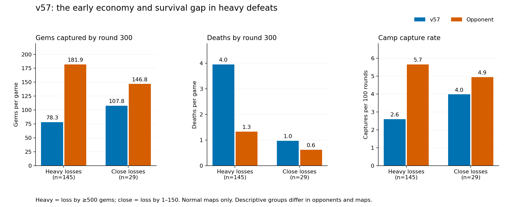

# Current rank-1 learning and v57 heavy defeats

v57 remains the submitted and fully evaluated bot. Its completed test is **47/100 challenge wins, 228/500 game wins**, against 100 distinct opponents. This follow-up studies stronger policies and prioritizes decisive losses; it does not alter or mix versions in that test. See [the completed verification report](../v57_eval_2026-10-23/REPORT.md).

## Prioritize large defeats

A heavy defeat means a normal-map loss by **at least 500 gems**. Close losses mean a **1–150 gem** deficit. Boss and gated-altar losses are separate. These are descriptive cohorts facing different opponents/maps, not causal treatment groups.

| Measure | Heavy defeats (145) | Close defeats (29) |
|---|---:|---:|
| Average score deficit | 790.81 | 86 |
| Our / enemy captured gems by round300 | 78.27 / 181.86 | 107.79 / 146.83 |
| Our / enemy deaths by round300 | 3.95 / 1.33 | 0.97 / 0.62 |
| Our / enemy total deaths per game | 21.41 / 3.8 | 5.41 / 4.76 |
| Our / enemy camp captures per100 rounds | 2.6 / 5.65 | 3.98 / 4.94 |

All heavy/close games reach round300. The data point toward early resource and survival deficits that compound. They do not prove every large defeat has the same cause.

### An economy failure without repeated PvP deaths

Against Nanyang Technological University on `01the_farm`, v57 lost **82–1,140** with only **one death**, caused by a camp. There was some nonlethal PvP, so the lack of kills alone does not prove absence of pressure.

- Captures: **11 versus31**; gems obtained from camps **190 versus1,184**.
- Our resource balance: **82 deposited +97 still carried +11 lost on death =190 captured**. Most of the deficit comes from acquiring too little, with an additional conversion shortfall, rather than repeatedly dropping large bags.
- Enemy balance: **1,140 deposited +44 carried =1,184 captured**.
- Our champions made **2,439 walking moves** across2,934 live turn ends. Round400–600 samples repeatedly circle the same region near(30,17), with visits home; this is a movement/clear/route stall, not a claim that every move was avoidable.
- The native action audit found **180 healthy melee turn ends** with a basic still available beside a personally visible awake camp and no personally visible enemy within6. **18** of those turns also damaged a camp with a spell. Target-group intent is unavailable, so these are candidate opportunities, not180 proven code errors.
- Source review found the camp executor rejects entry below42k fuel. That is a plausible contributor to missed actions, but this replay does not expose the bot's internal fuel at that branch. The specific causal branch remains unproven; no untested budget change was shipped.

The same audit records2 such opportunities on `00road_of_riches` and16 on `01shortcut`, illustrating that large defeats have different mechanisms. Evidence: [native frame investigation](farm_frame_investigation.json), [action opportunities](camp_opportunities.json), [all heavy losses and top20 cases](heavy_losses.json).

## Fresh rank-1 sample

Current rank1 was **Intercontinental Fish**, verified from the ladder via HTTP. Downloaded **20 recent games**, including a ranked0–5 defeat to rank9 `new team(4)`, a3–2 series against rank4 `procless`, and4–1 series against rank27 `BBL` and rank40 `Quant Merch Traders`. The sample intentionally includes strong opponents and defeats. Its11/20 wins are **not** an estimate of Fish's overall win rate. Public source versions are hidden in these match records.

Every native replay's scores, winner and final round were checked. The old20 October Fish report described an earlier patch and is not used as current evidence.

**Identifier caution:** website draft IDs use `DRAFT_CHAMPIONS`; live entities use `CHAMPION_TYPES`. In particular draft11 is **Heart of Ruin**, not Tavi. The initial readout was corrected before implementing these experiments.

Current core: **Vesper Vale, Vendetta, Heart of Ruin**, commonly adding **Cassi & Issac and Ryth**. Some layouts substitute Varg. Our core overlaps; roster copying alone cannot explain or fix the strategy gap.

Observed behavior:

- Vesper receives **48.2%** of this sample's camp-gold receipts, including passive and item bonuses. This is income concentration, not proof of deliberate funneling. Vesper has a33% gold passive; Treasure adds20%, so gross gold share overstates base reward allocation.
- Vesper's observed normal build is Treasure Strength → Bruiser Strength → Durability Health → repeated Power Strength. The other roles receive much less income. This is a hypothesis about coordinated carry economy, not evidence that the build transfers independently to our controller.
- The sample averages **159.5 wards per game**. Its casts often damage camps: **80.8 camp-damaging casts versus19.4 enemy-damaging casts per game**. A single cast may count in both, and shield-only damage is excluded.
- Fish is not always a single pack: the mean largest connected alive component is **65.1%** of the team, using links at Chebyshev5. **26.0%** of alive champion samples have no ally within6. These omniscient proximity measures are not tactical safety judgments, and the deliberately selected sample is small.

Raw evidence: [strategy profile and per-champion builds](strategy_profile.json), [full native metrics](metrics.json), [download index](games/index.json).

## Test the mechanism, not just copy the winner

Each experiment freezes exact sources and uses all40 current maps ×3 opponents ×both sides =240 schedules per bot. Opponents are v56, v57 and v27; they are historical/local controls, not the rank-1 team's private source. No experimental v58 has been uploaded.

| Equipment experiment | Wins/240 | Paired gains / losses | Mean margin change |
|---|---:|---:|---:|
| Frozen v57 | 164 | — | — |
| Observed Vesper build | 156 | 8 / 16 | -15.6 |
| Our protected opening, then Strength | 161 | 4 / 7 | -10.7 |

Both equipment-only variants are rejected: they lose wins and mean margin. All720 games finished without native faults or source changes.

Our existing `X_CARRYMODE=2` prefers poorer allies. A separate test changes only nearby capture allocation to favor Vesper, plus a combined allocation-and-build variant. The existing distance and commitment requirements still apply; allies do not wait for a distant Vesper.

| Allocation experiment | Wins/240 | Paired gains / losses | Mean margin change |
|---|---:|---:|---:|
| Frozen v57 | 164 | — | — |
| Vesper capture priority | 172 | 35 / 27 | +24.6 |
| Capture priority + observed build | 152 | 20 / 32 | -23.8 |

### Stronger holdout and selection verdict

| Controller | Wins/160 | Mean gem margin |
|---|---:|---:|
| Frozen v57 | 118 | 302 |
| Vesper capture priority | 114 | 292.5 |

Against v55 the allocation variant fell45/80→40/80; against the Mite approximation it rose73/80→74/80. This fails the recorded positive-win-and-margin holdout criterion. Across all560 matched schedules, the result is438→443 wins, with53 gains and48 losses. The change is **not selected or uploaded**. v57 remains active. Source hashes are unchanged, with zero native faults across all these tests. See [selection verdict](FUNNEL_VERDICT.json).

## Enemy fingerprints within a match

A minimal online movement model was tested on the20 current Fish replays, independently for each observing champion and enemy, resetting each game. Features were previous movement direction, near/far distance and enemy HP bin; updates used past personal observations only. Evaluation used48,121 consecutive personally visible observations, excluding gaps and displacement over3. Stay-put exact prediction was45.96% (mean Chebyshev error0.6192), constant velocity45.98% (0.7581), and learned transitions45.38% (0.7399). It did not beat the simple baselines and is not selected. This is conditional visible-to-visible accuracy, not hidden-position accuracy or a win-rate result. See [online experiment](online_fingerprint_summary.json).

The higher-level policy described below is a proposed next layer, **not an enabled v57 feature**. Source inspection finds persistent camp beliefs, but no comparable enemy-behavior history. Each champion could keep a small local record per observed enemy: last visible round/position, HP, items, cooldown evidence, and decayed counts of approach, retreat, pursuit and observed camp/altar visits. Runtime observations should refine generic priors, not select opponent-name exceptions.

Useful decisions to test:

1. Avoid repeatedly contested farming routes when the same visible enemy keeps returning, while preserving an alternative productive task.
2. Limit chases against opponents that repeatedly retreat toward allies; do not assume an unseen ambush is present.
3. Reuse observed farming/altar transitions for short-horizon interception only when reaching the objective is affordable and safe.
4. Adjust retreat/pursuit expectations from several comparable observations, conditioned on HP, nearby support and ready abilities; a single retreat is insufficient evidence.

Predictions must carry age and confidence. Unseen actions make cooldowns uncertain, and Vendetta kills reset cooldowns, so old cooldown readings cannot be treated as exact. Direct observations and legal action checks override learned expectations. Do not train on omniscient enemy features and then feed the bot only partial vision. Hold out whole matches/opponents/dates; random adjacent-frame splits would leak nearly identical states.

The rules matter: vision is personal, each champion has its own process, the shared team buffer is only8 bytes and is already used for coordination, and draft memory is1024 bytes/read-only after drafting. Rich histories belong in local instance memory; only a compact urgent signal could be shared without redesigning the packet. Reset online history between matches; any offline prior must be explicit and validated.

The platform test has100 opponent groups of5 games; within-opponent results can be correlated. A larger corpus reduces sampling noise but does not remove opponent/map/version confounding.

Acceptance should include win rate **and heavy-loss frequency**, early camp/gem income, deaths, wasted travel, calibration and fuel. Overconservative threat predictions already caused offsetting losses in the rejected lethal-route experiment, so learning must not make avoidance an absorbing state.

## Rules refreshed

Freshly fetched the current handbook entry and its referenced service bundle, docs asset, champion-grid asset and patch notes using terminal HTTP scripts. All match the refreshed local sources byte for byte. Re-read combat, camp capture, scoring, items, drafting, vision, shared memory, Vesper, Heart, Vendetta and relevant caster/duo rules during this review. The latest published balance note is1.0.2; replay metadata labels the build1.0.3. No undocumented balance change is inferred from that label difference. See [verification](docs_check/verification.json).

Latest read-only platform check (2026-10-23T07:25:39.923Z): active **v57**, rank **70**. The earlier completed-evaluation snapshot was rank65. Unranked results are not used to claim a causal rank gain. No follow-up candidate was uploaded.
