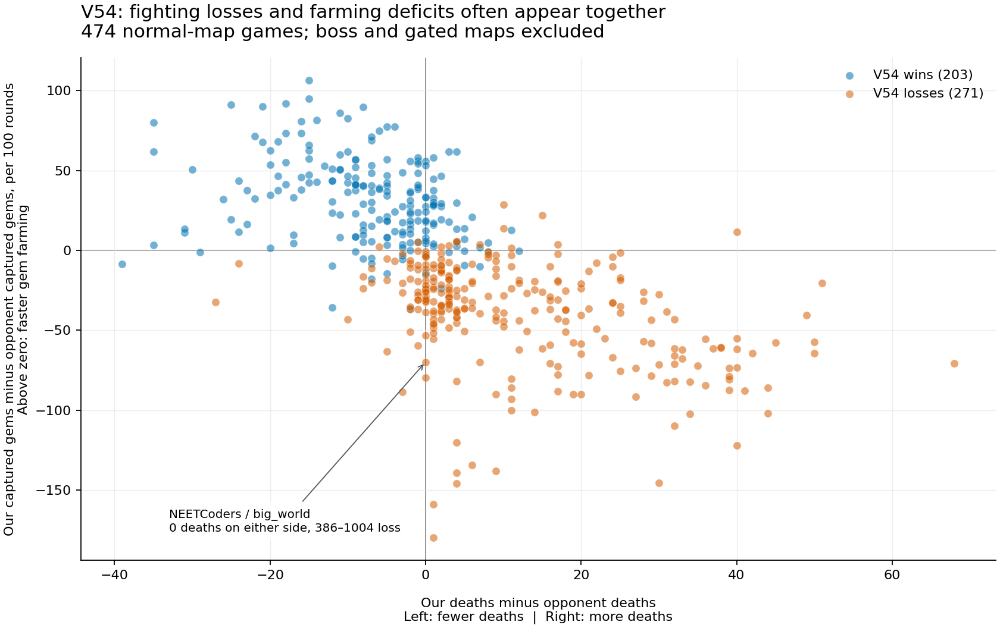

# Teammate v54: completed unranked evaluation

Generated 2026-10-22T19:04:01.047Z. All 100 requested five-game challenges are represented.

## Bot and test design

The teammate upload selected at the start was **v54**, submission **9ffe9fbb-c82d-4160-8491-0c79772cc4bf**. All 26 freshly downloaded files match the v54 source reviewed earlier. It adds progressive static distance fields for camp/altar selection and avoids unnecessary work during channels and captures. Combat, builds, gate policy and the boss branch retain the previous behavior. No bot code was edited, uploaded, or activated for this evaluation.

The account was rank **46** when sampling started; the comparison center is **23**. Each pool contains the 25 closest eligible opponents, with two five-game challenges per opponent. The nearby pool spans ranks 33–59, excluding our team and a team without a bot. The stronger pool spans ranks 11–35. Three opponents occur in both pools, on different map schedules. These ranks are frozen sampling labels, not claims about the live ladder after testing.

A later live status check at 2026-10-22T19:01:58.093Z listed the team at rank **58** with v54 active. The sampled pools remain fixed at the starting rank, so this ladder movement does not silently change the evaluation.

For each opponent, the second challenge repeats the same five maps with all sides reversed. Across the complete schedule, all 40 maps appear 12 or 14 times, exactly half from each side. Pools are interleaved while respecting the shared rolling quota. This fixes the old evaluation’s map/side confounding. A challenge is won by winning at least three of its five games.

## Results

| Opponent pool | Games won | Five-game challenges won |
|---|---:|---:|
| Near rank 46 | 121/250 (48.4%) | 25/50 (50.0%) |
| Near rank 23 | 86/250 (34.4%) | 8/50 (16.0%) |
| Total | 207/500 (41.4%) | 33/100 (33.0%) |

The earlier promotion targets were at least **35/50 nearby challenges** and **29/50 stronger challenges**. V54 misses the nearby target and misses the stronger target.

## What its fighting looks like

Its usual normal-map lineup is Heart of Ruin, Vesper Vale, Ryth, Marcella and Vendetta, with fewer picks on smaller-team maps. The standard build opens with Treasure, then Jungle, then Bruiser Health. Champions split into farming tasks, with some grouping on large camps. Combat is evaluated before ordinary tribute and farming; a personally visible enemy can divert a champion from its economic task. The tactical planner scores a small number of immediate attack/cast/move plans using an approximate two-turn enemy response.

In the **271 normal-map losses**, our team averaged **15.75 deaths** versus **3.96** for the winner. **54.07%** of our deaths happened with more enemies than allies within six tiles; **36.65%** were an isolated champion with at least two enemies nearby. Allies include the victim. This is a spatial support measure, not proof that every nearby unit could immediately attack or that the victim could see everyone.

At sampled basic-attack contact starts in those losses, our side was outnumbered **32.79%** of the time versus **10.8%** for opponents. A contact start means a basic attack on an enemy champion after more than ten rounds without that champion making such an attack. It misses spell-only engagements and does not imply the attacker initiated the overall encounter.

I separately inspected personal champion vision masks in four selected losing games. This confirms that some bad fights occur even when multiple opponents are visible, rather than being explained entirely by hidden information. These four games are illustrative, not a random prevalence sample. Masks are queried immediately after the first basic attack, against the preceding living positions.

**Concrete example: Tartarus, `00monolith`, match `96f422b2-eebd-4628-ad1e-c172845d3428`.** At round 449, our Ryth had 78% HP, no other ally within six tiles, and three visible enemies: Marcella, Vesper Vale and Ryth. It attacked/reset/attacked Marcella, continued attacking at round 450, began moving at round 452, and died at 453. The game ended 500–1002. This shows a poor local fight becoming an escape attempted too late. It does not prove that an arbitrary earlier move would have saved it.

**Another example: Nyx, `00collision`, match `67c8c5f3-13b8-4c72-be7e-f47265e1778d`.** Our Heart entered a sampled contact at round 1006 at about 97% HP while alone near visible Heart and Ren, and died at 1010. Our Vesper entered another at round 1246 at full HP against the same two enemy types and died at 1252. The final score was 93–1062, with 21 deaths versus one. These are not merely champions starting every fight already critically injured.

Once a low-health episode starts outside spawn (below 35% HP), **35.6%** of our resolved episodes in normal-map losses end in death, versus **19.5%** for opponents. An episode resolves at death, reaching spawn, or recovering to at least 60% HP; unfinished episodes are excluded. This supports improving escape timing and route safety, but is observational evidence rather than a causal estimate of any particular fix.

**Draft/build counterexample:** EMPEROR Tung won 8/10 games despite identical champion lineups in all ten. All 37 comparable full three-emblem opening sequences matched, as did all 42 available first-three prefixes. This directly separates the performance gap from merely choosing different opening items.

## How it loses the economic race

Normal-map winners capture **4.98 camp groups per 100 rounds** against our **3.17**. Our team makes about **76.8 walking moves per captured group**, versus **54.48**. These are whole-team throughput measures, not path inefficiency for an individual journey: fighting, recalls, destination changes and deaths all affect them.

Our mean completed deposit in those losses is **20.92 gems** versus **31.82**, and **54.8%** of our deposits contain fewer than 20 gems versus **33%**. Frequent small deliveries can protect bags, but they also interrupt farming and add travel. This is a testable tradeoff, not evidence that every small tribute is wrong.

**Concrete example: NEETCoders, `01big_world`.** In matches `4b9c7e5c-979f-42a0-8546-df3682b4a6ca` and `385602f2-eef1-4a58-a30f-0e71d5acbb04`, neither team died at all. We lost 386–1004 and 292–1012. Total captures were 31–65 and 28–59; gem-bearing captures were 23–61 and 21–56. A combat-only change cannot solve this gap. Destination quality, clear/capture cycles, gold-versus-gem priorities, and delivery cost all matter.

## How the winners differ

These fixed ten-game matchups show more than one successful strategy. EMPEROR Tung wins 8/10 with the same lineup and opening emblems, while capturing 5.64 groups per 100 rounds against our 3.20 and suffering 3.4 deaths per game against our 8.3. Ad Astra also wins 8/10; its observed openings emphasize Jungle, then Durability Health, followed by Bruiser in a damage stat on several champions. It averages 1.9 deaths against our 24.3, and 5.00 captures per 100 rounds against our 2.56.

Subscribe to caterpillow wins 7/10 despite dying more often: 4.0 deaths per game against our 1.7. It takes 4.21 gem-bearing groups per 100 rounds against our 3.41, with only 2.85% gold-only captures against our 10.02%. Its observed builds emphasize Focus on Heart/Marcella and Strength on Vesper/Varg. This is a scoring-efficiency counterexample to any claim that reducing deaths is sufficient on its own. These are observed associations on the assigned maps, not isolated tests of emblem choice.

## Boss and gate losses

Pure boss map 00contest: **1/14 (7.1%)** wins. Gated map 01boss_battle: **3/12 (25.0%)** wins. These require separate policies from ordinary farming maps.

**Pure boss combat failure:** against Nyx on 00contest, we scored zero on both sides while the opponent scored 1,000 and 600. We received zero gem-bearing capture rewards and suffered 86 and 113 champion-body deaths. In the 113-death game, every death had a recorded champion killer, and the recorded damage from camp attacks was only 360. That collapse is a champion-fighting/board-control problem, alongside any steal-policy or range-estimation issue.

**Gate deadlock:** versus NEETCoders, matches `7abe1684-c01c-4469-8baa-c46b04c6567e` and `95a935db-a8a6-4c93-b2d4-4b3840cb1ae5` both reached round 2000 at 0–0 submitted gems. We carried 4,286 and 3,854 gems and started zero tributes; neither Monolith gate died. They are losses under the timeout tiebreak, not draws. Rules compare submitted gems, then lifetime earned gold, then kills, then favor Team B if everything still ties. The official summaries confirm the first tiebreak decided both: lifetime gold was 36,000–49,127 and 33,440–49,285, respectively.

The source explains why the bot can wait indefinitely: `X_GATESTEAL=true` makes `workBankGate()` decline to work a gate unless a recently observed HP estimate is at or below 30% of maximum. If both sides wait, farming more gems does not create altar access. Against Valenki in match `91fdd205-bbf9-4828-a865-69aeb0bac1be`, both gates eventually died, but the opponent won 1049–0 while we still carried 3,859 gems and had made zero tribute starts. Opening access and reaching/using it in time are distinct problems.

**Additional confirmed boss-branch defect:** in match 352cb213-219d-4ea9-b6b0-07a8b9f3c325 against EggsAfter11AM, our Tavi carried 200 gems and attempted a tribute at rounds 1366 and 1437. Both calls were rejected with SDK error 125, invalid_action_submit_gems_altar_locked. The boss tribute routine lacks the regular branch’s lock check/removal step. These were handled action errors, not bot crashes; the game ended 0–1000. The replay and logs establish the defect, but not that fixing those two attempts alone would win the game. See [locked-altar evidence](locked_altar_case.json).

## What the geometry change has established

The first-altar geometry log occurs in **486/500 games**, with a median logged round of **73** across champion instances. It establishes that preprocessing executes. It does **not** establish that all camp fields are ready: the source only uses camp fields once every relevant resource field is complete, and it does not log that transition. The pure boss branch does not use this warmup.

Logged bot/API errors appeared in **1/500 games** and **20 ordinary turns reaching the fuel limit out of 2,901,811** audited ordinary turns. Native replay Bot-error counters total **0** for our side. Reported cross-round suspensions: **20**. Rare suspensions should still be examined, but the current evidence does not point to widespread runtime failure as the main loss mechanism.

The live service, rules and champion-data assets were fetched through HTTP and matched the earlier verified copies byte for byte. The replay corpus uses engine v1.0.3. The known five defects from the [v53 review](../v53_opponent_review/REVIEW.md) remain in unchanged code: inconsistent shield treatment in escape scoring, only one cached damaging enemy spell, missing enemy area radius in response estimates, gate-channel threat protection restricted to Cassi/Issac although the gate draft lacks them, and a range-four Monolith safety assumption against actual range five. These are verified code defects; this evaluation does not assign a loss count to each.

This sample measures current v54 strength. It is **not a controlled v53-versus-v54 experiment**: the opponent pool, time, opponent uploads and map schedule differ from the older test. Any historical matching subset is descriptive only. A causal estimate of the geometry patch needs an interleaved, paired old/new test against the same frozen opponents, maps and sides.

An additional policy inconsistency is documented in [TACTICAL_FALLBACK.md](TACTICAL_FALLBACK.md): a nonpositive tactical plan can fall through to the old attack/chase policy, which does not repeat the tactical exchange-value test. This is a verified source path and a candidate explanation, not a measured attribution of replay losses.

## Improvements worth testing next

1. Correct the verified threat-estimation defects first, then measure ten-round survival after contact and normal-map scoring. Preserve personal-visibility constraints.
2. Improve fight/escape decisions with actual available support, enemy burst and safe destinations. A blanket rally or outnumber threshold is not justified: earlier variants using those switches were already unsuccessful. Use targeted changes and holdout opponents.
3. Reduce delivery overhead when another profitable gem cycle is safe, while retaining immediate winning tributes and emergency banking. Track gems scored per round and time spent travelling/channeling, not just average bag size.
4. Add boss-branch altar-lock handling, and give gated/boss maps an explicit access decision: commit to a feasible clear, contest a steal, or deliberately optimize the timeout economy. Waiting for someone else to reduce a gate below 30% must not be the only plan. Handle the open-gate delivery window separately.
5. Add a full-camp-geometry-ready diagnostic in a future bot version, and test whether earlier readiness changes destination choices and capture throughput. No such instrumentation was added to this bot during the evaluation.

## Per-opponent results

| Pool | Frozen rank | Opponent | Games won | Challenges won | Deaths/game, ours : theirs |
|---|---:|---|---:|---:|---:|
| half | 11 | Tartarus | 2/10 | 0/2 | 8.8 : 4.6 |
| half | 12 | EMPEROR Tung | 2/10 | 0/2 | 8.3 : 3.4 |
| half | 13 | NEETCoders | 2/10 | 0/2 | 13.6 : 7.1 |
| half | 14 | hello | 0/10 | 0/2 | 19.9 : 11.6 |
| half | 15 | Let's LARP again | 4/10 | 1/2 | 11.9 : 13.7 |
| half | 16 | Sneaky Bush Campers | 3/10 | 0/2 | 21.6 : 6.2 |
| half | 17 | Ad Astra | 2/10 | 0/2 | 24.3 : 1.9 |
| half | 18 | Nanyang Technological University | 3/10 | 0/2 | 7.3 : 3.9 |
| half | 19 | ひななー | 4/10 | 0/2 | 10.5 : 6.6 |
| half | 20 | subscribe to caterpillow | 3/10 | 0/2 | 1.7 : 4 |
| half | 21 | Noobot | 2/10 | 0/2 | 12.6 : 3.6 |
| half | 22 | print dont int | 3/10 | 0/2 | 17 : 9.4 |
| half | 23 | Zarzorki | 3/10 | 0/2 | 25.6 : 7 |
| half | 24 | FürFortnite | 3/10 | 0/2 | 24.5 : 4.8 |
| half | 25 | conqueror_of_openai | 4/10 | 0/2 | 7.2 : 7.9 |
| half | 26 | BBL | 4/10 | 0/2 | 16.3 : 5 |
| half | 27 | OneTap | 2/10 | 0/2 | 17.2 : 4.3 |
| half | 28 | Supaswag | 5/10 | 1/2 | 5.3 : 11.1 |
| half | 29 | geese geese go | 3/10 | 0/2 | 7.9 : 6.6 |
| half | 30 | Mite | 6/10 | 2/2 | 12 : 12.4 |
| half | 31 | SquidProxyLovers | 8/10 | 2/2 | 14.7 : 17.6 |
| half | 32 | EggsAfter11AM | 4/10 | 0/2 | 17 : 10.2 |
| half | 33 | Nyx | 5/10 | 1/2 | 15.6 : 4.8 |
| half | 34 | Sloppy Joe Pirates | 5/10 | 1/2 | 13.6 : 5.8 |
| half | 35 | dromedaries | 4/10 | 0/2 | 13 : 7.6 |
| near | 33 | Nyx | 4/10 | 0/2 | 30.4 : 7.2 |
| near | 34 | Sloppy Joe Pirates | 5/10 | 1/2 | 16.2 : 4.9 |
| near | 35 | dromedaries | 5/10 | 1/2 | 9.7 : 10.9 |
| near | 36 | Nameless | 3/10 | 0/2 | 12.2 : 4.5 |
| near | 37 | SSSA | 2/10 | 0/2 | 9.4 : 8.6 |
| near | 38 | Valenki | 3/10 | 0/2 | 7.5 : 5.2 |
| near | 39 | PENTAKILL | 5/10 | 1/2 | 15.7 : 9.5 |
| near | 40 | Lucky Lock Pickers | 7/10 | 2/2 | 11.3 : 15.9 |
| near | 41 | ha²t | 8/10 | 2/2 | 12.7 : 10.8 |
| near | 42 | Jupiter | 5/10 | 1/2 | 7.8 : 2.4 |
| near | 43 | 𓎼𓃭𓅱𓂋𓇌 𓏏𓅱 𓂋𓄿 | 5/10 | 1/2 | 10.4 : 14.2 |
| near | 44 | HouseOfCoders | 4/10 | 1/2 | 17.3 : 6.4 |
| near | 45 | E=mc^2+AI^3 | 5/10 | 1/2 | 6.4 : 7 |
| near | 48 | DOOMSDAY | 7/10 | 2/2 | 4.8 : 4.1 |
| near | 49 | Bamboo Teahouse | 6/10 | 2/2 | 12.7 : 10.6 |
| near | 50 | smurphy | 8/10 | 2/2 | 10.4 : 20.3 |
| near | 51 | the uncancelables | 5/10 | 1/2 | 13.7 : 4.9 |
| near | 52 | 2/27TELEVIZR+1/6EIT | 5/10 | 1/2 | 7.2 : 5.3 |
| near | 53 | The Mania | 3/10 | 0/2 | 5.1 : 10.3 |
| near | 54 | wawow | 6/10 | 2/2 | 6.6 : 6.9 |
| near | 55 | Rogue Fog Walkers | 2/10 | 0/2 | 12.7 : 3 |
| near | 56 | filter | 3/10 | 0/2 | 4.2 : 4.3 |
| near | 57 | Still Testing | 6/10 | 2/2 | 5.9 : 19.8 |
| near | 58 | Quant Merch Traders | 7/10 | 2/2 | 7 : 13.1 |
| near | 59 | 剑桥夜爬者 | 2/10 | 0/2 | 49.2 : 4.8 |

## Per-map results

| Map | Wins | Deaths/game, ours : theirs | Captures/100 rounds, ours : theirs |
|---|---:|---:|---:|
| 00ambush | 10/14 | 3.07 : 6 | 3.37 : 3.6 |
| 00collision | 6/14 | 10.93 : 4.5 | 3.25 : 5.46 |
| 00contest | 1/14 | 70.79 : 8.43 | 2.76 : 6.22 |
| 00corners | 3/14 | 17.79 : 4.86 | 3.76 : 6.42 |
| 00eight | 7/14 | 21.86 : 7.57 | 2.53 : 3.1 |
| 00elkring | 6/12 | 8.5 : 4.17 | 4.61 : 5.03 |
| 00expanse | 10/12 | 1.08 : 1.33 | 5.51 : 6.94 |
| 00fragment | 2/12 | 26.67 : 4.92 | 2.2 : 3.89 |
| 00gem_fields | 4/12 | 9.67 : 4.58 | 3.79 : 4.89 |
| 00gemfight | 4/12 | 18.83 : 5.83 | 2.8 : 4.55 |
| 00great_wall | 7/12 | 5.33 : 8.92 | 3.53 : 3.88 |
| 00interlock | 9/12 | 8.42 : 11.42 | 3.82 : 3.69 |
| 00lanes | 2/12 | 11.92 : 4.67 | 5.18 : 7.17 |
| 00lost_world | 7/14 | 6.36 : 15.36 | 5.84 : 6.84 |
| 00monolith | 0/14 | 11.64 : 4.21 | 5.31 : 5.48 |
| 00packs | 6/14 | 18.86 : 4.5 | 1.96 : 2.71 |
| 00pilgrimage | 9/14 | 14 : 7.93 | 4.35 : 3.95 |
| 00quadrants | 2/14 | 9.93 : 2.43 | 3.19 : 3.64 |
| 00reverse_spiral | 8/12 | 7.67 : 12.5 | 2.52 : 3.6 |
| 00road_of_riches | 2/12 | 7.25 : 2.67 | 3.01 : 6.97 |
| 00rows | 2/12 | 0.25 : 0.75 | 3.78 : 3.99 |
| 00rushbait_v2 | 4/12 | 7.17 : 5 | 3.9 : 4.67 |
| 00split | 3/12 | 3.92 : 3.58 | 4.71 : 5.29 |
| 00stampede | 8/12 | 8.17 : 16.33 | 5.91 : 4.31 |
| 00swirl | 3/12 | 33.5 : 9 | 1.95 : 3.92 |
| 01big_world | 2/12 | 0.42 : 0.67 | 3.11 : 3.71 |
| 01boss_battle | 3/12 | 5.17 : 4 | 6.72 : 5.3 |
| 01broken_curve | 1/12 | 3.92 : 1.67 | 3.48 : 5.42 |
| 01concentrated_wealth | 5/12 | 15.5 : 4.08 | 1.97 : 3.92 |
| 01corridors | 6/12 | 6.92 : 7.67 | 2.16 : 2.02 |
| 01elk_arena | 5/12 | 26.75 : 18.08 | 7.65 : 7.58 |
| 01fracture | 2/12 | 3.83 : 2.58 | 3.7 : 4.81 |
| 01gold_rush | 9/12 | 9.92 : 24.33 | 7.23 : 3.81 |
| 01hooks | 6/12 | 26.42 : 19.08 | 3.83 : 4.92 |
| 01islands | 8/12 | 4.5 : 3.17 | 3.19 : 3.83 |
| 01shortcut | 6/12 | 12.25 : 12.33 | 2.08 : 3 |
| 01starfish | 8/12 | 18.58 : 20.5 | 2.68 : 2.11 |
| 01starvation | 8/12 | 16.67 : 18.5 | 3.56 : 2.02 |
| 01the_farm | 4/12 | 6 : 4.83 | 2.02 : 2.48 |
| 01yellow_brick_road | 9/12 | 13.67 : 16.08 | 3.32 : 2.77 |

## Coverage and audit limits

500 unique replays, 104,623,530 native replay steps visited, 0 decode failures and 0 worker failures. Each decoded final score, winner and round count was checked against the platform index. Side A: 107/250 (42.8%); side B: 100/250 (40.0%). Complete mirrored map/opponent pairs: 250; both won 69, split 69, both lost 112.

Deaths include camp deaths and both linked bodies if applicable. Enemy-nearby measures use Chebyshev distance six and omit intervening walls, action availability and personal vision unless explicitly stated. Capture counts use native reward steps and count a split reward once for the team. Completed-deposit sizes use increases in submitted gems. Gem bags held at death are not automatically destroyed; champion kills transfer them. The “winning bag” metric only indicates enough collective carried gems in principle, not a safe or feasible tribute.

Official match summaries independently checked: 500; discrepancies in deaths, captured groups, capture gems, reward receipts and scoring: 0. Summary artifacts retain the official decoder’s unrecognized-version name labels; numeric identities and metrics were used for the audit.

Artifacts: [plan](plan.json), [accepted challenge receipts](receipts.json), [platform groups](groups/), [game/replay index](games/index.json), [frame metrics](metrics.json), [aggregated patterns](patterns.json), [banking/recovery summary](summary.json), [vision examples](visibility_details.json), [build orders](build_patterns.json), [log/fuel audit](log_audit.json), [official audit](official_audit.json), [official summaries](official_summaries/), [source hashes](source_hashes.json), [source](source/).
