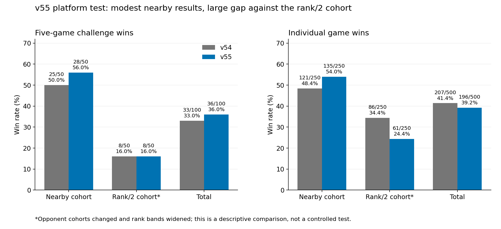
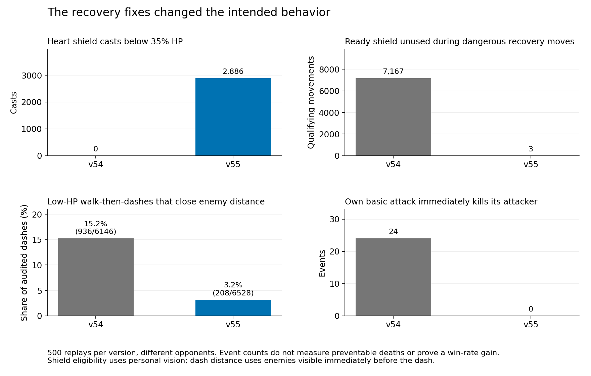
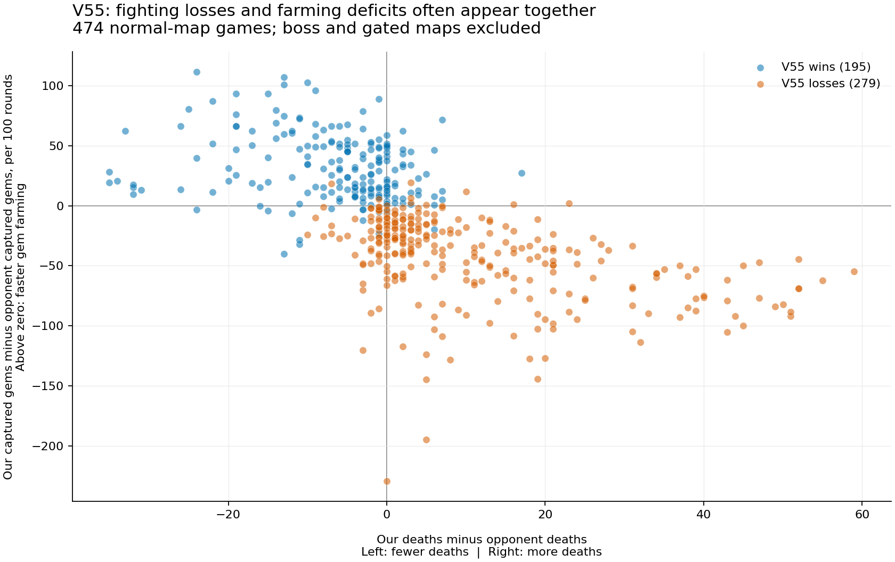

# v55: completed 100-challenge evaluation

The requested iteration is complete: v54's losses were analyzed, fixes and strategies were tested, the selected candidate was submitted as **v55**, and **100 unranked challenges / 500 games** were completed and verified. Recovery behavior improved, but **the platform results do not establish an overall performance improvement**.

Submission: `b3f3f93d-2c20-4bea-9290-0473eaadb1b5`, created Oct 23 01:11 IST. All 26 uploaded source files match the tested candidate. [Frozen source](source/src/), [development source](../../workspace/bots/codex-v55/).

At the final platform check, Oct 23 09:50 IST, **v56 was already active** and the team was rank 73. The newer bot was left untouched. This report concerns the frozen v55 test; the current team rank is not attributed to these unranked matches.

## Final results

Each challenge contains five games.

| Cohort | Challenge wins | Individual game wins |
|---|---:|---:|
| Nearby | **28/50 (56%)** | **135/250 (54%)** |
| Rank/2, widened | **8/50 (16%)** | **61/250 (24.4%)** |
| Total | **36/100 (36%)** | **196/500 (39.2%)** |

The previous v54 run won 25/50 nearby challenges, 8/50 rank/2 challenges and 207/500 individual games. v55 therefore has three more challenge wins but eleven fewer game wins. **The opponent samples differ, so neither difference establishes the code change's causal effect.** Previously recorded promotion targets of 35/50 nearby and 29/50 rank/2 challenges were not met.

The test used frozen starting centers of rank 50 and half-rank 25. The first 50 challenges had already been accepted against 25 teams with reversed sides when the user requested broader opponent coverage. The remaining 50 used **50 distinct new teams**. Total coverage is **75 distinct teams**, exactly 50 challenges per cohort, all 40 current maps, 125 A-side and 125 B-side games per cohort, and equal side counts on every map.

Avoiding already-used opponents widened nearby coverage to snapshot ranks 37–77 and the rank/2 cohort to 1–53. The latter includes two teams at ranks 52–53 and is not uniformly a stronger-opponent sample. Rankings can also drift. [Original schedule](plan_before_unique_preference.json), [final schedule](plan.json). Future batches use distinct opponents from the start, without repeating a team merely to reverse sides.

## Changes submitted

1. **Threat forecast:** evaluates ready abilities in both slots, includes AoE radius, and applies our shield consistently when comparing staying with moving. Previously a stronger spell on cooldown could hide a weaker ready one.
2. **Recovery:** Heart can shield at low health, including before an optional finishing attack. Optional melee attacks skip immediately lethal Ren retaliation. Retreat dash selection preserves minimum separation from initially known threats; low-fuel fallback retains the dash. This is not a complete damage-aware escape planner.
3. **Tribute safety:** applies the ready-interrupt check to the full actual gate draft; explicitly removes enemy altar locks in the separate boss tribute branch.
4. **Regular-map equipment:** Jungle damage stat → Durability Health → Bruiser damage stat → Bruiser Health, then alternating Bruiser Health/damage. This replaces the initial Treasure purchase; boss/gate shops retain their separate plans.
5. **Geometry computation:** stops background warm-up when every field is ready and logs full readiness separately. Geometry decisions are unchanged.

No opponent-name or map-name strategy exceptions were added. [DEVELOPMENT.md](../v55_improvement_2026-10-23/DEVELOPMENT.md) records enabled flags and rejected experiments. Broader retreat rules, relative-health trade scoring, further tribute delays, boss frontline changes and forced boss clearing were rejected after negative or inconclusive local results.

## Validation

Production-source counterexamples reproduce and verify the ready-secondary-spell, AoE-edge and shield-comparison fixes. Final local validation used an exact frozen v54 control:

| Local schedule | v54 | v55 |
|---|---:|---:|
| 40 current maps × 3 local opponents × both sides | 191/240 | 196/240 |
| 23 archived maps × 2 held-out local opponents × both sides | 87/92 | 88/92 |

Current-map paired results were 22 gains and 17 losses; held-out results were one gain and zero losses. Mean deposited gems decreased slightly in both schedules; the holdout score margin worsened by 11.5 gems. These modest gains justified a platform test, not a claim of a stronger ladder bot. Local opponents include historical own bots and approximations, not top teams' private source. [Local validation graph](../v55_improvement_2026-10-23/local_validation.png).

The native behavioral audit processed all 500 games from each platform run:

| Behavior | v54 | v55 |
|---|---:|---:|
| Heart shield casts below 35% HP | 0 | 2,886 |
| Ready shield unused in qualifying dangerous recovery movements | 7,167 | 3 |
| Low-HP walk-then-dashes reducing visible-enemy separation | 936/6,146 (15.2%) | 208/6,528 (3.2%) |
| Own basic attack immediately killed its attacker | 24 | 0 |

Shield eligibility uses personal vision and engine readiness: movement outside spawn, visible enemy within six, and no later cast that turn. Dash measurements use enemies visible immediately after walking and before the dash. Counts verify changed behavior, not preventable deaths. Different opponents and game lengths limit causal comparisons. The remaining closing dashes show that minimum distance to initial threats is still an incomplete safety criterion.

## Remaining losing patterns

Across **279 normal-map losses**, opponents retain large fighting and economy advantages:

| Measure | v55 | Opponent |
|---|---:|---:|
| Champion deaths per game | 15.22 | 4.13 |
| Group captures per 100 rounds | 3.28 | 5.22 |
| Gem-group captures per 100 rounds | 2.26 | 3.74 |
| Mean completed deposit, gems | 20.69 | 33.19 |
| Deposits below 20 gems | 54.4% | 31.5% |
| Low-health episodes ending in death | 33.7% | 19.4% |

**Fight selection and coordination:** 52.3% of our deaths in normal-map losses occur with more enemies than allies within Chebyshev six. This uses omniscient proximity and does not establish visibility or avoidability. Separate personal-vision examples confirm some avoidable isolated contacts. Better shielding and spell arithmetic alone do not solve unfavorable engagements or losing contested farming space.

**Farming throughput:** 55 losses show an economy deficit without a large death gap; 47 losses occurred with fewer deaths than opponents. These categories overlap. Across all 474 normal games, clear-to-capture delay is already reasonable: median six rounds for us versus seven for opponents. The larger deficit is reaching and clearing enough valuable groups safely. Merely adding capture helpers is unsupported by these timings. Small deposits warrant investigation, but the tested extra deposit delay performed worse locally.

**Special maps:** only **1/14 pure-boss games** and **0/12 gated games** were won. The boss branch retains an older combat planner and a steal-oriented policy that can leave 0–0 gem games decided by gold. Its range-four positions remain inside the Monolith's range-five threat radius; moving every caster to range six would put most spells out of range. Tested frontline and forced-clear changes lacked positive evidence.

Next experiments should prioritize coordinated engagement/disengagement, safe access to valuable camps and a boss-specific plan, each compared against a frozen control before another platform batch. These are investigation priorities, not proven unimplemented fixes.

## Verification and limitations

- All **100 challenges finished**, with 500 unique games and no pending challenge requests.
- All 500 replay archives and official summaries were collected. Native decoding processed **100,890,506 steps**, using engine `v1_0_3`. Scores, winners and rounds agree with platform data; official death/capture/reward/banking summaries have **zero discrepancies**.
- All 500 logs contain the expected v55 build marker. There were **zero native bot faults**, but this was **not error-free**: 13 ordinary inputs reached the fuel limit out of 2,802,992, ten cross-round suspensions were logged, and one caught engine error 5 occurred in farming after a suspension. Match `b32edf4c-dfa1-4214-8a56-45ee51ab005d`, `01elk_arena`, round 1107, was a loss. Error 5 reports invalid metadata/alignment/overlap/argument; its precise root cause remains unestablished.
- No locked-altar error 125 appeared; encounter coverage is insufficient to prove all lock situations are handled.
- Full geometry readiness was logged in 468 games, median completion round 405 across logged instances. Old logs only recorded first-altar readiness, preventing a full-readiness comparison.
- Handbook entry HTML and patch notes matched the previously verified rules source. Static asset rechecks returned 403, so complete fresh verification of every rules asset is not claimed. [Docs check](docs_check/verification.json).

Evidence: [FINAL_VERIFICATION.json](FINAL_VERIFICATION.json), [platform_results.json](platform_results.json), [summary.json](summary.json), [mechanics_audit.json](mechanics_audit.json), [official_audit.json](official_audit.json), [log_audit.json](log_audit.json), [final_platform_snapshot.json](final_platform_snapshot.json). Charts are reproducible with `plot_final.py` and `plot_patterns.py`.
