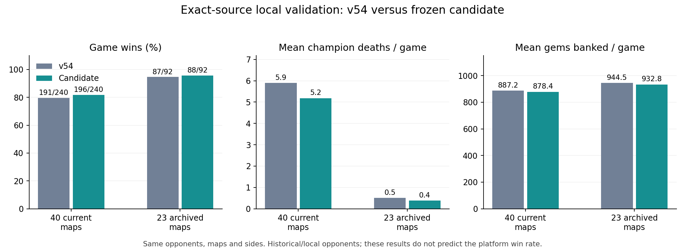

# v54 loss analysis and candidate development

Baseline: v54, submission 9ffe9fbb-c82d-4160-8491-0c79772cc4bf. The prior evaluation verified 100 challenges / 500 games against native replay steps and official summaries. v54 won 25/50 nearby challenges and 8/50 rank/2 challenges (207/500 games).

## Findings and changes

- Normal-map losses: 15.75 champion deaths per game versus opponents' 3.96; 54.07% of our deaths occurred with more enemies than allies within Chebyshev 6. These proximity counts use omniscient replay positions, and do not by themselves establish visibility or cause. Separate personal-vision audits verified several avoidable isolated contacts.
- Incoming-damage forecast discarded weaker ready spells when the strongest spell was cooling down, omitted AoE radius, and compared shield-adjusted staying damage with unadjusted walking damage. Production-source counterexamples reproduce all three errors and pass with the correction.
- Low-health Heart did not use its shield; retreat dashes followed the home route without preserving separation. Optional melee hits could kill their attacker through Ren retaliation. The candidate enables Heart shielding, rejects immediately lethal optional retaliation trades, and chooses retreat dash landings that preserve distance from the known threats. If there is insufficient fuel, it retains the dash.
- Regular gate-channel safety was limited to Cassi/Issac, while the actual gate draft used other champions. The candidate applies the ready-interrupt check to the full draft. It remains a conservative estimate from personal vision, not certainty that the enemy will cast.
- The separate boss tribute branch lacked explicit altar-lock removal. The old corpus contains two error-125 attempts with a 200-gem Tavi. The candidate clears enemy locks before starting tribute. This does not prove those two attempts alone caused that loss.
- Farming/capture rate was the larger economy gap: 3.17 versus 4.98 captures per 100 rounds in normal-map losses. Completed clear-to-capture delay was already good (median 6 rounds versus 7), so adding capture helpers is not the appropriate fix. Candidate jungle-first equipment trades early Treasure growth for camp damage reduction and earlier farming strength.
- Geometry is unchanged in its decisions. The candidate stops the background warm-up once every field is complete and logs full readiness separately from the first-altar message.

## Selection experiments

Each screening condition uses the same opponent/map/side schedule; source snapshots are frozen. Local opponent implementations are historical own bots and approximations, not the current top teams' private source. Counts below are individual games, not five-game platform challenges.

| Batch | Variant | Wins | Control wins | Paired gained/lost | Mean gem margin delta |
|---|---|---:|---:|---:|---:|
| screen | fix | 56/72 | 58/72 | +2/−4 | -59.9 |
| screen | decline | 52/72 | 58/72 | +4/−10 | -157.1 |
| screen | economy | 51/72 | 58/72 | +5/−12 | -153.4 |
| strategies | safe | 54/72 | 58/72 | +6/−10 | -74.3 |
| strategies | jungle | 59/72 | 58/72 | +5/−4 | -23.4 |
| strategies | combo | 55/72 | 58/72 | +4/−7 | -43.2 |
| trades | relative | 57/72 | 58/72 | +2/−3 | -14.3 |
| trades | relativeDecline | 53/72 | 58/72 | +3/−8 | -136.1 |
| trades | bank | 56/72 | 58/72 | +3/−5 | -46 |
| escape | care | 57/72 | 58/72 | +4/−5 | -4.3 |
| escape | careJungle | 60/72 | 58/72 | +5/−3 | 4.1 |
| jungle_full | jungle | 105/126 | 102/126 | +8/−5 | 4.2 |
| boss | front | 10/12 | 10/12 | +0/−0 | 0 |
| boss | commit | 7/12 | 10/12 | +0/−3 | 16.7 |

The baseline in these screening batches contains disabled experiment code. The final validation uses an exact independent v54 source snapshot to avoid relying on equivalence of compiler/fuel behavior. The initial broad-map batch used an outdated 21-entry local map index; final validation enumerates all 40 actual current map files explicitly.

Rejected for this submission: blanket retreat after rejected trades, visible-camp danger scoring, health-ratio trade scoring, further tribute batching, a boss frontline draft, and forced boss clearing. Most lost games locally; the frontline draft tied and lacks positive evidence.

## Frame-level recovery evidence

The native champion API was queried from Heart's own perspective immediately after low-health movement steps in two selected v54 losses. The SDK coordinate/HP fields were checked against the replay state, cooldown and shield amount came directly from the engine, and casts were tracked through turn end. In the Tartarus match 96f422b2-eebd-4628-ad1e-c172845d3428, Heart moved at rounds 116/117/118 with HP 320/260/200 out of 1000; its 150-point shield was ready and no spell was cast on any of those turns. The full selected audit is recovery_evidence.json. Other audited turns include safe travel/spawn contexts: the count of available unused shields is not a count of preventable deaths or a representative prevalence estimate.

## Frozen candidate

workspace/bots/codex-v55. Enabled experiments: X_FORECAST, X_CHANNELALL, X_BOSSLOCK, X_JUNGLEFIRST, X_ESCAPECARE. Other new experiments remain disabled. Final candidate also shields before optional finish attacks and guards the low-fuel dash fallback; those small corrections are covered by the final exact-source validation.

## Remaining weaknesses

The pure-boss branch still has an older combat planner and its steal-only policy can produce 0–0 gold-tiebreak games. Its range-four casting positions are inside the current Monolith range-five threat radius; no range-four immunity is claimed. A genuinely safe ranged ring cannot simply be moved to range six because most spells would no longer reach. Broad combat avoidance performed worse locally, so those failed policy changes are not enabled merely because the old replay death count is high.

## Final validation and platform test

Final exact-source validation passed with no bot faults, missing games, or source changes:

- All 40 current maps × three opponents × both sides: candidate **196/240**, exact v54 **191/240**; paired **22 gained, 17 lost**, mean score-margin change **+10.3 gems**.
- All 23 archived maps × two held-out opponents × both sides: candidate **88/92**, exact v54 **87/92**; paired **1 gained, 0 lost**, mean score-margin change **−11.5 gems**.
- These gains are modest and the held-out score margin is slightly worse. They are sufficient to justify a platform test, not a guarantee of a better ladder bot.

The native summaries record mean deaths and deposited gems in local_validation_metrics.json. Candidate and control source hashes are in each final evaluation's sources.json. The candidate was uploaded as v55, compiled, and all 26 submitted source files were verified against the tested candidate. The completed platform verification contains exactly 100 challenges: 50 around a frozen starting rank and 50 in the widened half-rank cohort, totaling 500 games across all 40 maps with balanced sides. Opponent rankings and bot versions can change between the old and new evaluations, so their raw win-rate difference will not be a controlled causal estimate.

## User sampling update during v55 verification

After the first 50 challenge requests had been accepted, the user asked to stop repeating the same opponent solely to reverse sides and instead broaden coverage. The sender was stopped while waiting on quota, with zero pending POSTs. The remaining 50 requests used 50 distinct opponents, all different from the 25 opponents already queued. The completed run covers 75 distinct opponents, retaining exactly 50 nearby-cohort challenges and 50 half-rank-cohort challenges. The original frozen centers remain 50 and 25, but nearest-unused selection necessarily widens rank coverage: new nearby opponents are ranks 54–77; new half-rank opponents are ranks 1–12, 25–36, and 52–53. Side balance remains exact on every map, without replaying these new opponents. The first 50 already-queued requests remain in the tally and the old plan is preserved. Future batches use distinct opponents from the start.

## Completed platform result

v55 won **28/50 nearby challenges (135/250 games)** and **8/50 widened rank/2 challenges (61/250 games)**, totaling **36/100 challenges and 196/500 games**. The previous v54 run won 33/100 challenges and 207/500 games. Opponent cohorts changed, so these differences do not establish a causal improvement. Recovery behavior changed substantially in the all-500 native audits: low-health Heart shield casts 0→2886, qualifying unused shield movements 7167→3, closing low-health walk-then-dashes 15.2%→3.2%, and own-basic immediate self-deaths 24→0. Fight coordination, farming throughput and boss play remain major weaknesses.

All 500 native replays and official summaries passed consistency verification. There were zero native bot faults, but one caught engine error 5 and 13 ordinary fuel-limit inputs. At the final check, teammate v56 was active and was left untouched. Full results, charts, sampling limitations and evidence: [v55 REPORT.md](../v55_eval_2026-10-23/REPORT.md).
