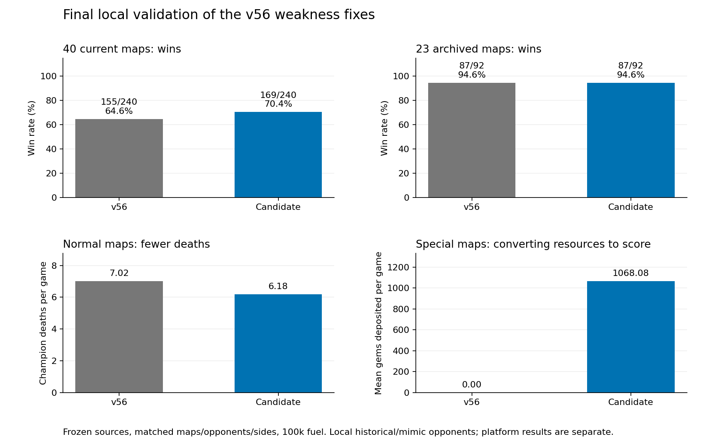

# v56 weakness fixes: final candidate

Baseline: v56 `bd552e32-5646-4404-bfe1-b46c0d1838bd`. All 28 server files are saved under `baseline/src`; the local frozen control differs only by CRLF→LF normalization, audited in `baseline_normalization.json`.

Selected source: `workspace/bots/codex-v57-final/src`. This preserves v56's hole-crossing dash, bank-lock, and low-fuel ABI improvements. The bot was uploaded as **v57**, submission `1c3f3610-725e-494e-b678-795c23ec79d2`; platform verification is tracked in `../v57_eval_2026-10-23/`.

## Enabled changes

- Restore per-slot ready spell forecasting and AoE reach, consistent shield comparison, low-health Heart shielding, safe optional retaliation checks, and retreat dashes that preserve minimum separation from initially known threats.
- A tactical escape explicitly ends the combat branch. A melee champion must not immediately resume farming movement after a dash-only escape.
- Pure-boss maps use the regular meta team/controller. Equipment starts Jungle Health, Durability Health, then Bruiser damage/Health growth. Champions build a generic capital threshold of 20 paid shard equivalents and at least half health before committing to a home-side Monolith. They use the regular camp actions, shielding and recovery rather than waiting for an enemy to nearly clear the boss.
- Mandatory-gate maps use that durable regular team and coordinated camp executor after the same equipment threshold. This replaces the separate steal-only spell task. Classification uses camp rewards and altar topology, not map names.
- An altar approach personally observed free can be used even while another monster in its group remains alive. Unknown approaches remain blocked. Dynamic firing geometry drops personally observed dead monsters, and optional spell task targeting focuses wounded targets. That old optional task is bypassed by the selected gate-objective strategy.
- Channel risk checks cover the actual gate draft and respect Marcella's stun immunity.
- Stop geometry warm-up after all fields are ready, with a separate full-readiness marker.

No opponent-name or map-name strategy exception was added. The 20-shard threshold was compared with 10/15/25 in local special-map tests; these are heuristic equipment thresholds, not a proof of optimal timing.

## Validation of the exact selected candidate

| Schedule | Frozen v56 | Candidate |
|---|---:|---:|
| All 40 current maps × 3 opponents × both sides | 155/240 | **169/240** |
| 23 archived maps × 2 other opponents × both sides | 87/92 | **87/92** |

Current-map paired results: **36 gains, 22 losses**, mean gem-margin change **+60.4**. Archived-map result: no win/loss flips, mean margin change **+57.1**. All 664 final validation games finished with no native bot faults or source changes. Local opponents are frozen historical bots and approximations, not current top teams' private source.

In current-map validation, normal-map deaths fell **7.02→6.18 per game**, captures rose **4.008→4.091 per 100 rounds**, and mean deposited gems rose **861.6→878.3**. Pure-boss wins were **6/6 versus 4/6**; gate wins **5/6 versus 4/6**. Across both special maps, mean deposits rose **0→1068.1**, and deaths fell **31.08→6.50**. The old controller's special-map wins were 0–0 tiebreaks, so win counts alone hide a much larger change in objective conversion. These small special-map samples do not establish performance against real top opponents.

Six additional logged matches cover both special maps, ambush, the large-world map on both sides, and the previous fuel-error map. They show zero caught bot/API errors, zero native faults, zero ordinary fuel-limit inputs or cross-round suspensions, and untruncated logs. The full 240-game candidate validation does contain **11 fuel-exhaustion events**, versus six for v56; the six-match log result is not an error-free claim about the entire corpus.

Production-source fixtures verify ready secondary spells, AoE edges, shield-adjusted escape choices, and using a personally observed free altar approach. A separate legal-spell-sequence fixture also passes, but that experimental model was not selected.

## Rejected changes and qualifications

The 800-game broad comparison rejected aggressive group withdrawal, the legal-sequence burst model with its tested risk limits, and adding awake-camp danger globally. Adaptive shopping looked promising in a small screen but lost three wins against the simpler candidate in broad testing; it is disabled. The area-spell camp optimizer and two-slot sustained-DPS estimate did not earn selection. Forcing the old fragile caster boss team to clear, or adding one tank to that controller, performed worse. Full screening tables and source snapshots are in `WORK_LOG.md` and the named batch directories.

The legal-sequence forecast removes impossible repeated use of an eight-turn spell, but the surrounding trade policy did worse with that less pessimistic estimate. The selected response model remains a conservative heuristic, not an exact two-turn game tree. Failed refinements remain disabled in the experiment source.

An early suspicion that static gate geometry made the rear monster permanently unreachable was too strong: the geometric audit finds alternative old firing tiles. Dynamic geometry adds three geometric positions in the tested layout; geometry alone does not prove visibility or casting availability. The separate whole-group-versus-free-approach bug is reproduced by the production-method fixture.

Recovery still does not guarantee the safest tile under every newly revealed threat. Fight coordination, route safety and deposit timing remain heuristic. The local gains are sufficient to justify the platform experiment, not to declare every major weakness solved.

## Artifacts and provenance

- `final_current/results.json`, `final_holdout/results.json`: matched results, full source hashes and frozen source snapshots.
- `final_current/behavior_metrics.json`: team metrics from official local summaries; gold-only captures are included through zero-gem camp receipts.
- `smoke/audit.json`: build identity, errors, faults, fuel and log limits.
- `regression_core.py`, `regression.cpp`, `regression_gate.cpp`, `regression_burst.cpp`: production-excerpt counterexamples.
- `rules_check.json`: handbook entry and patch notes unchanged against prior verified sources. Static assets were not freshly rechecked; complete live-document verification is not claimed.
- Large completed screening summaries are stored losslessly as `.json.gz`, with compact `.json` result records. `statistics_archives.json` records original SHA-256 values. Every raw replay is preserved.

The new platform batch uses 100 distinct opponents, one challenge per opponent, with 50 nearby-cohort and 50 half-rank-cohort challenges and balanced map sides. Rankings/opponent samples differ from previous batches, so raw cross-batch win rates are descriptive, not controlled estimates of the code's effect.

## Matched native mechanics audit

All 240 current-map control and 240 candidate replays were independently decoded, with no failures and matching winners, scores and rounds. The same schedules show the intended recovery mechanisms operating:

| Native observed behavior | Frozen v56 | v57 |
|---|---:|---:|
| Low-health Heart shield casts | 0 | 1,392 |
| Qualifying unused-shield recovery movements | 2,936 | 10 |
| Low-health walk-then-dashes reducing visible enemy separation | 374/2,409 (15.5%) | 89/2,907 (3.1%) |
| Immediate own-basic self-deaths | 8 | 0 |

These are behavior counts, not estimates of preventable deaths. The native definitions and individual examples are in `native_base/mechanics_audit.json` and `native_candidate/mechanics_audit.json`. Outnumbered deaths on normal maps remained approximately 2.89/game in each version; their share rose as other deaths fell. Group fight selection is not solved.

## Separate live-replay follow-up (not part of v57)

The first public replay batch exposed a known lethal routing mistake against dromedaries on the gated map. A 2,720-HP Vendetta moved from (22,16) to (22,17), entering a visible Marcella's ready range-four spell. At 1,515 Focus, the spell dealt 2,727 damage after Durability. The caster was personally visible on rounds 594–596; this specific death cannot be attributed to fog of war. The enemy also had far greater equipment capital. See the frame and vision investigations in `../v57_eval_2026-10-23/`.

A narrow travel-only lethal-range mask is being tested independently against frozen v57. It does not alter the active v57 source or its 100-challenge experiment. A separate 144-game ward-budget/Marcella-Focus screen produced no convincing win gain. No follow-up variant has been uploaded.

The broad routing follow-up completed all 480 games (240 matched schedules per bot): frozen v57 **164/240**, travel-mask candidate **165/240**, **25 gains and 24 losses**, mean margin +7.5. No native faults or source changes. This one-win gain with many offsetting regressions does not establish a robust improvement, so the candidate is **not selected or uploaded**. The known routing weakness remains disclosed. This schedule compares v57 against itself/v56/v27 and differs from the original final-selection schedule, which used v55 as one opponent.

## Subsequent rules verification

While studying current rank-1 replays, freshly fetched the handbook HTML, its referenced service entry bundle, docs and champion-grid JavaScript assets, and patch notes using the normal authenticated HTTP-only workflow. All bytes match the refreshed local docs sources. Current replay metadata uses patch ID1.0.3; the latest published balance note remains1.0.2. These labels alone do not establish a rules discrepancy. See `../rank1_learning_2026-10-23/docs_check/verification.json`.
