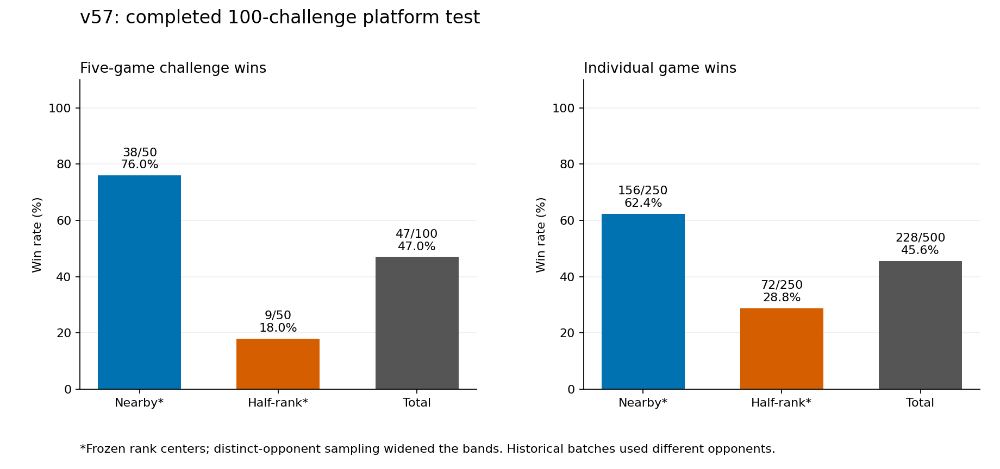
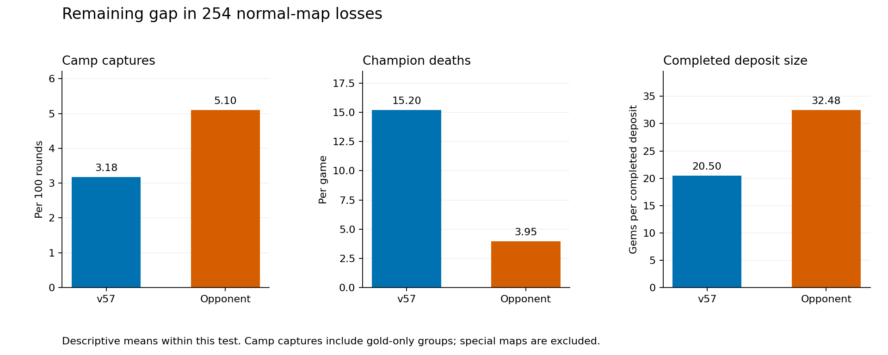

# v57: weakness fixes and completed platform verification

The candidate was submitted as **v57**, `1c3f3610-725e-494e-b678-795c23ec79d2`. All 28 uploaded source files match the tested candidate. The requested verification contains **100 challenges / 500 games against 100 distinct opponent IDs**, with no deliberately repeated opponent to reverse sides.

## Platform results

| Cohort | Challenge wins | Individual game wins |
|---|---:|---:|
| Nearby, widened | 38/50 (76.0%) | 156/250 (62.4%) |
| Half-rank, widened | 9/50 (18.0%) | 72/250 (28.8%) |
| Total | 47/100 (47.0%) | 228/500 (45.6%) |

The frozen starting rank was **54**, half-rank **27**. Closest-unused sampling produced nearby snapshot ranks **53–103** and half-rank ranks **2–52**. Each cohort has 50 challenges and 125 A-side / 125 B-side games; all 40 maps are covered and each map is side-balanced overall. Opponent ranks and versions can drift. The first 50 and second 50 were sent in separate quota windows.

The older v55 batch won 36/100 challenges and 196/500 games, using 75 distinct opponents and different rank bands. Its raw rate is not a controlled estimate of this code change's effect. Incoming challenges or other matches outside our issued batch are excluded from this tally.

## Changes and controlled validation

- **Boss and gate objectives:** durable regular teams build equipment, then commit to a home-side Monolith or mandatory gate. This replaces waiting for enemies to almost clear bosses. Classification uses map topology and camp rewards, not map names.
- **Recovery and tactical correctness:** restore ready-slot/AoE threat estimates, consistent shield comparisons, low-health Heart shielding, optional retaliation checks and safer retreat dashes. An escape cannot immediately fall through to farming movement.
- **Altar access:** a personally observed approach clear of living camps can be used before every monster in its group is dead. Channel checks cover the actual draft and respect Marcella's stun immunity.
- Preserve v56's hole-crossing dash, bank-lock and low-fuel ABI work. Stop geometry warm-up once complete.

Final controlled local validation: **169/240 wins versus v56 155/240** on all 40 current maps; **87/92 each** on 23 archived maps. Current-map paired results were 36 gains and 22 losses, with +60.4 mean gem margin; archived margin improved by 57.1. All 664 final local games completed without native faults or source changes. Local opponents are historical bots/approximations, not private top-team source. The control source differs from the downloaded original only by line-ending normalization.

Normal-map local deaths fell 7.02→6.18/game; group captures rose 4.008→4.091/100 rounds. The matched native audit observed 0→1,392 low-health Heart shield casts, 374/2,409→89/2,907 low-health walk-then-dashes reducing visible enemy separation, and 8→0 immediate own-basic self-deaths. These are behavior counts, not estimates of prevented deaths. Local pure-boss wins were 6/6 versus 4/6; gated wins 5/6 versus 4/6. Baseline special-map wins were zero-score tiebreaks; the candidate actually banked gems. Broad testing rejected several more aggressive combat and economy experiments. Full sources, fixtures, rejected variants and local limitations are in [DEVELOPMENT.md](../v56_improvement_2026-10-23/DEVELOPMENT.md).

## Special maps and remaining weaknesses

- **Pure boss: 6/14 wins**, mean deposited gems 557.1.
- **Gated altar: 2/12 wins**, mean deposited gems 234.3.

Across **254 normal-map losses**, our deaths averaged **15.2** per game versus **3.95** for opponents; group captures were **3.18 versus 5.1 per 100 rounds**. Mean completed deposits were **20.5 versus 32.48 gems**. **52.7%** of our deaths occurred with more enemies than allies within Chebyshev six. That is an omniscient proximity proxy, not proof of personal visibility or avoidability.

These figures describe remaining weaknesses rather than proving every major weakness solved. The matched local analysis also found that outnumbered deaths per normal game were essentially unchanged even while other deaths fell. The selected fixes improve recovery and objective conversion; coordinated fight selection remains a distinct problem.

A personally visible lethal-routing mistake was verified frame by frame in the dromedaries gated game: Vendetta walked into a ready Marcella spell dealing 2,727 damage against 2,720 HP. A separate travel guard then scored 165/240 versus frozen v57 164/240, with 25 gains and 24 losses. It was not selected or uploaded; v57 remained frozen throughout this platform test. A ward-budget/Marcella-Focus screen also failed to establish a convincing gain. The detailed local report records these rejected follow-ups.

## Verification

- All 100 groups finished; all 500 games are unique and use v57. No pending challenge request remains.
- Native decoding validated **99,799,706 steps** against platform scores, winners and rounds. Replay failures: **0**. Official-summary discrepancies: **0**.
- Every game log contains the expected build marker. Platform bot faults: **0**. Caught-error games: **1**. Ordinary fuel-limit inputs: **20 / 2,776,161**; logged cross-round suspensions: **21**. Zero decoding failures is not an error-free execution claim.
- The all-500 native mechanics audit records **3,185 low-health Heart shield casts**, **9 qualifying unused-shield recovery movements**, **179/6953 low-health walk-then-dashes reducing personally visible enemy separation**, and **0 immediate own-basic self-deaths**. Definitions are in mechanics_audit.json; counts do not equal preventable deaths.
- Handbook entry HTML and patch notes matched previously verified sources during development. A subsequent HTTP-only check freshly fetched the current handbook entry, service entry, docs and champion-grid JavaScript assets and patch notes; all matched the refreshed docs byte for byte. See [the fresh rules check](../rank1_learning_2026-10-23/docs_check/verification.json). The latest published balance note is 1.0.2 while the recorded replay patch ID is 1.0.3; those labels are not treated as evidence of an undocumented rules change. The archived official summary decoder is provenance-tagged; every downloaded summary's size and SHA-256 are checked.

At the final snapshot (2026-10-23T06:57:37.427Z), active version was **57** and team rank **65**. This is observational metadata, not a causal rank-gain claim.

Caught-error examples:

- `34575648-906e-49e7-865c-04e407cb1b8b` / 01boss_battle: bot error: engine error 97: Unit is not in vision. round 750 at fight

Evidence: [FINAL_VERIFICATION.json](FINAL_VERIFICATION.json), [platform_results.json](platform_results.json), [summary.json](summary.json), [official_audit.json](official_audit.json), [mechanics_audit.json](mechanics_audit.json), [log_audit.json](log_audit.json), [frozen source](source/src/). All raw replay archives are preserved.
