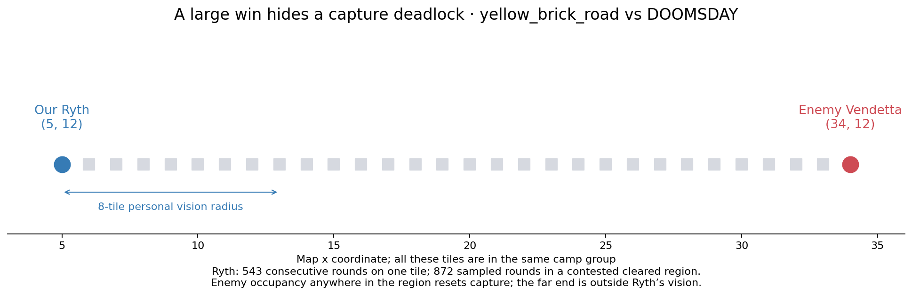
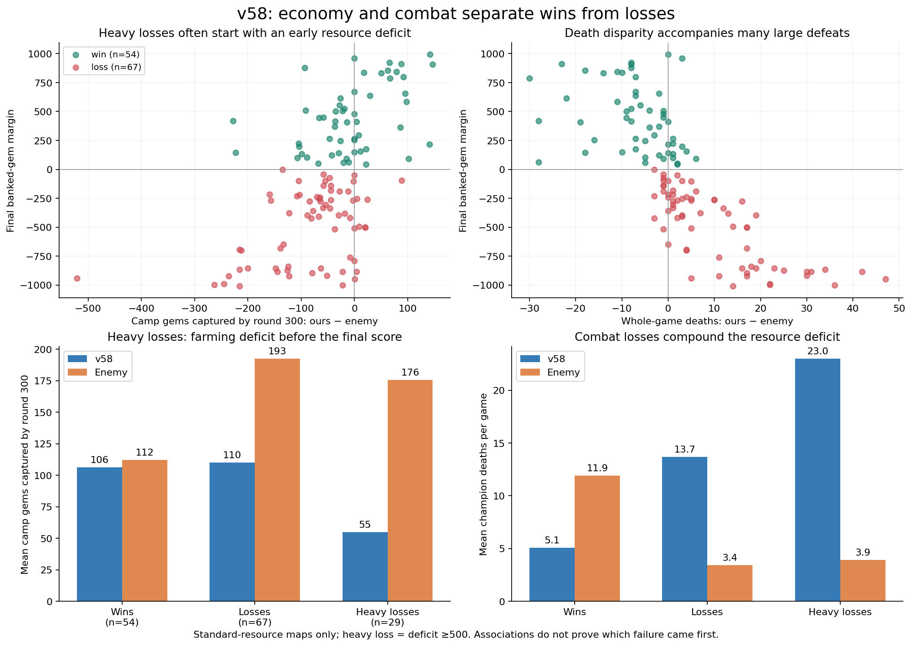
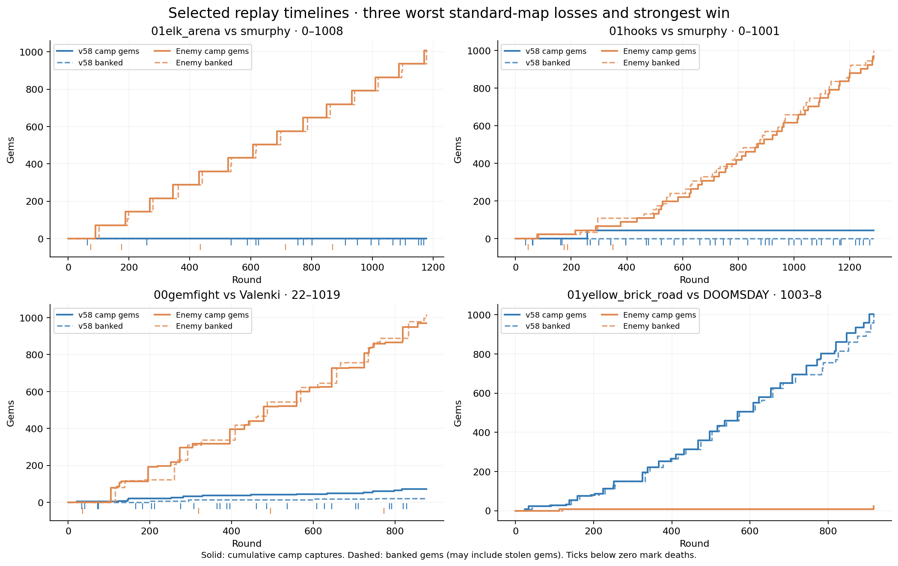
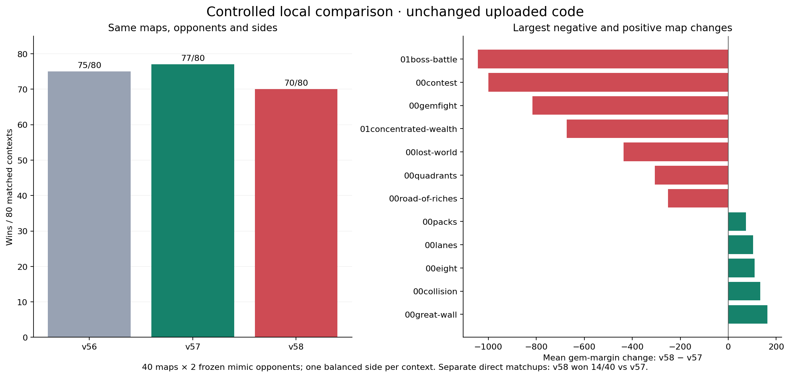

# v58 weaknesses and flaws — code, strategy, and replay evidence

**Reviewed upload:** v58, submission `8f42f685-6d52-4cae-896c-cbb27925a808`  
**Uploaded:** 23 October 2026, 18:39:12 IST  
**Replay cutoff:** 23 October 2026, 19:28:59 IST  
**Scope:** flaws present in this exact v58 upload. No production code changes, activations, submissions, or new challenges were made for the audit or this report.

## 1. Verdict

v58 runs reliably, but its decisions contain several confirmed defects and its measured strategy has substantial weaknesses. It is a **v56 branch with staged dash-bridge routing**, rather than a continuation that retains v57's changes. That distinction explains why a number of improvements previously present in v57 are absent here.

The strongest findings are:

- A distance-four monolith firing ring is treated as safe, although the current engine gives monoliths **attack range five**.
- A cleared but contested camp can hold a champion indefinitely. A winning replay contains **543 consecutive rounds on one tile**, with no stun.
- Enemy threat forecasts can both **overestimate** danger by repeating a cooling spell and **underestimate** it by omitting AoE splash reach.
- The normal controller can continue into other tasks after a tactical withdrawal, and its low-HP recovery omits Heart's shield.
- The default gate roster cannot enter the specialized channel-threat/carrier-retreat protection path because that path only accepts Cassi and Issac.
- Large losses often involve an early gem deficit followed by a combat collapse; earning gold or clearing many groups does not necessarily become scoring progress.
- The one substantial feature new to v58, staged bridging, produced **five losing flips and no winning flips versus v56** in the matched local test.

These findings do **not** establish that every loss has one of these causes, that every v57 change should be copied blindly, or that all fixed heuristics are overfitting. Each finding below identifies its evidence, uncertainty, and a concrete validation target.

## 2. How to read this report

### Evidence labels

| Label | Meaning |
|---|---|
| **Confirmed code/rule defect** | The uploaded code contradicts a verified rule, or an exact code path/counterexample demonstrates the error. This does not measure how many matches it changed. |
| **Observed strategic weakness** | The behavior is present in real v58 replays. Its exact root cause may involve several decisions. |
| **Controlled regression** | Unchanged versions were tested on the same local opponent/map/side contexts, and v58 performed worse on that set. |
| **Experiment candidate** | A v58 policy has a plausible weakness, but no isolated benefit from changing it has been demonstrated. |
| **Maintenance limitation** | A property of this upload increases the chance of inconsistent fixes or misleading diagnosis; it is not evidence of a runtime crash. |

### Version attribution

“Specific to v58” here means **demonstrably present in this upload**, not necessarily invented in this upload. Findings distinguish:

- **New in v58:** the staged-bridge implementation and its measured regressions.
- **Inherited and still active:** behavior shared with its v56 base.
- **A v57 safeguard absent from v58:** a branch difference, not proof that the absence alone caused a given loss.

The source under [`supporting_docs/source/`](supporting_docs/source/) is an unchanged copy of the downloaded v58 files. Snippets are exact excerpts, with original line numbers stated above each block. No proposed fix is presented as existing uploaded code. The [file-by-file guide](supporting_docs/SOURCE_GUIDE.md) covers all 29 files.

### Navigation

1. [Dataset and performance](#3-dataset-and-performance)
2. [Finding index and priorities](#4-finding-index)
3. [Confirmed defects and strategic failures](#5-detailed-findings)
4. [What winning and losing look like](#6-winning-and-losing-patterns)
5. [Controlled version comparison](#7-what-the-local-comparison-proves)
6. [Repair and validation plan](#8-repair-and-validation-plan)
7. [Limits and non-findings](#9-limits-and-non-findings)
8. [Package contents and provenance](#10-package-contents)

## 3. Dataset and performance

The original audit paginated to the end of team activity and then refreshed its newest entries. It identified v58 using match-level version metadata and group-level submission IDs. At the cutoff there were **135 v58 match records: 130 completed and five queued**. The queued games had not played and had no replay. Games after the stated cutoff are outside this frozen report.

| Platform category | Game wins | Five-game set wins | Distinct opponents | Mean banked-gem margin |
|---|---:|---:|---:|---:|
| Ranked | 12/25 | 4/5 | 5 | −26.5 |
| Unranked | 43/105 | 7/21 | 11 | −183.2 |
| Combined | **55/130 (42.3%)** | **11/26** | **14 across both categories** | **−153.1** |

Ranked performance needs both views: four 3–2 set wins and one 0–5 set loss produce a good set record but fewer than half of individual games won. Five ranked sets are insufficient for a confident long-run estimate. Unranked opponents were repeated; this is not the previous test with 100 distinct opponents.

All **130 replays**, spanning **40 maps**, were decoded through **26,502,007 native engine steps**. Outcomes, scores and round counts matched all 130 official summaries. Gem conservation also passed for both teams in every game. The audit found:

- Zero native replay decoding failures or official score/outcome discrepancies.
- Zero official bot faults for either side in this corpus.
- Zero caught API-error logs and zero logged suspensions for v58.
- Zero ordinary fuel-ledger inputs at the per-turn limit.
- No changes to the downloaded source or frozen local-test inputs.

This matters: **the principal weaknesses identified here are decision and strategy problems, not demonstrated crashes or fuel exhaustion**. See [verification](supporting_docs/evidence/VERIFICATION.json), [log audit](supporting_docs/evidence/log_audit.json), [official aggregates](supporting_docs/evidence/official_aggregates.json), and [all completed matches](supporting_docs/MATCHES.md).

## 4. Finding index

Priority reflects scoring impact and strength of evidence, not a proved ordering of implementation gains. P1 items deserve focused correction or investigation before threshold tuning; P2 items require isolated experiments; P3 items concern maintainability.

| ID | v58 finding | Category | Attribution | Priority |
|---|---|---|---|---|
| F01 | Monolith range-four “safe” ring lies inside actual attack range | Confirmed code/rule defect | Inherited and active | P1 |
| F02 | Mandatory gate/boss policy waits for another team to do most clearing | Observed strategic weakness + restrictive code policy | Inherited; v57 proactive policy absent | P1 |
| F03 | Capture waits have no no-progress timeout | Confirmed mechanism + observed stall | Inherited and active | P1 |
| F04 | Two-turn forecast reuses the same spell across its cooldown | Confirmed code defect | Inherited; v57 sequence forecast absent | P1 |
| F05 | Enemy AoE threat omits splash reach and compresses spell choices | Confirmed counterexample + modeling limitation | Inherited; v57 slot/radius forecast absent | P1 |
| F06 | Tactical withdrawal is not preserved by the caller | Confirmed control-flow defect | v57 withdrawal flag absent | P1 |
| F07 | Low-HP Heart recovery does not use its ready shield | Code omission + observed unused opportunities | v57 recovery safeguard absent | P1 |
| F08 | Specialized gate-carrier protection excludes the actual default gate roster | Confirmed inactive protection path | Inherited and active | P1 |
| F09 | Parting/finishing attacks bypass Ren-retaliation safety | Confirmed hazardous code path; frequency unmeasured | v57 retaliation safeguard absent | P1 |
| F10 | Gold farming can fail to become gem throughput | Observed strategic weakness | Active v58 scoring/build policy | P1 |
| F11 | Rejected tactical plans can fall back into a separate chase policy | Code-level inconsistency; match impact unisolated | v57 decline/no-chase safeguards absent | P2 |
| F12 | Combat forecast omits awake-camp incoming damage | Confirmed modeling omission; contribution unisolated | v57 camp-danger term absent | P2 |
| F13 | Camp spell selection lacks useful-area optimization | Candidate-quality limitation | v57 area-center scorer absent | P2 |
| F14 | “Poorest-first” compares cash on one side but not the other | Confirmed metric asymmetry; policy effect untested | Inherited, active carry mode 2 | P2 |
| F15 | Fixed shopping recall threshold may trade too much throughput for investment | Experiment candidate | Inherited; v57 adaptive threshold absent | P2 |
| F16 | New staged bridging loses matched games without a winning flip | Controlled regression; exact internal cause unresolved | **New in v58** | P1 investigation |
| F17 | Duplicate controllers and an all-fields geometry barrier complicate consistent decisions | Maintenance/modeling limitation | Present in v58 | P3 / targeted profiling |
| F18 | Home-directed retreat dash need not preserve walking separation | Hazardous code path; outcome effect unmeasured | v57 escape-dash safeguard absent | P2 |

## 5. Detailed findings

### F01 — The monolith “safe ring” is not safe by range

**Classification:** confirmed rule/model mismatch. **Status in v58:** inherited and active in both the dedicated boss path and the mandatory-gate setup.

The current rules and an independent native engine 1.0.3 design query agree that a monolith attacks at **Chebyshev range 5**. The source creates a ring at exactly distance 4 and comments that it preserves a safety margin.

**v58 source:** [boss/bot.cpp](supporting_docs/source/src/boss/bot.cpp#L1187), lines 1187–1202.

```cpp
    if(bossOnly && g.monolith && g.state!=2) {
        // Range-three basics surrender the only safety margin. Cast from
        // exactly range four, then wait for cooldown instead of walking in.
        bc::bitboard ring;
        for(auto p:g.tiles){bc::bitboard outer,inner;outer.draw_chebyshev(p,4);inner.draw_chebyshev(p,3);ring|=outer & ~inner;}
        // A geometric range-four destination can be blind behind walls/bushes.
        // Record an actually observed blind landing; explore another legal
        // ring tile rather than repeatedly waiting for an invisible target.
        if(ring.is_set(pos) && !anyCampVisible && !tileVisible)blindBossTiles.set(pos,true);
        ring &= ~blindBossTiles;
        for(auto p:(bc::vision::camp_tiles() & g.tilesBB).positions())try {
            const auto monster=bc::vision::camp_at(p);
            if(cheb(pos,p)==4 && castOnCamp(monster))return;
        }catch(const TurnAbort&){throw;}catch(...){}
        if(!ring.is_set(pos))moveToward(ring,false);
        return;
```

The mandatory-gate controller uses the same geometric assumption:

**v58 source:** [v1_bank_access.h](supporting_docs/source/src/v1_bank_access.h#L20), lines 20–23.

```cpp
    bankGate=gate;if(gate<0)return;
    for(auto p:groups[gate].tiles)gateFiring.draw_chebyshev(p,4);
    for(auto p:groups[gate].tiles){bc::bitboard danger;danger.draw_chebyshev(p,3);gateFiring&=~danger;}
    gateFiring&=~staticBlocked;
```

The problem extends beyond the comment. Boss target scoring estimates **zero camp damage** for monolith clears, relying on the presumed safe position:

**v58 source:** [boss/bot.cpp](supporting_docs/source/src/boss/bot.cpp#L1112), lines 1112–1118.

```cpp
        const float rawKt = reward ? 0.0f : hp / (ownDamage + dps[g.id]);
        const float kt = rawKt * ((bossOnly&&g.monolith)?1.0f:(1.0f + g.totalStr / 100.0f));
        const float time = d + wait + kt + 5.0f;
        const float value = g.gems + 0.15f * g.gold;
        float score = value / (time + 8.0f);
        // camps hit the nearest champion: avoid fights we cannot survive without help
        const float taken = (bossOnly&&g.monolith)?0.0f:rawKt * g.totalStr * (jungle ? 0.7f : 1.0f);
```

A champion at distance four can be attacked. Another nearer body might draw aggro, or a sleeping camp might not yet attack, but neither condition follows from this ring. The planner is therefore allowed to approve a clear under a false survival assumption.

**Evidence:** [native camp designs](supporting_docs/evidence/native_camp_stats.json) and the [rules snapshot](supporting_docs/rules/GameRules.md). Wolf range is 3, Elk/Golem range is 4, and Monolith range is 5; one common range constant is not adequate.

**Correction direction:** use native range and current aggro state; explicitly budget a tank, shields, sustain, control and rotations. Merely moving the ring outward can make the spells unable to reach, so “change 4 to 6” is not a complete solution.

**Validation target:** no planner should call a tile safe solely because it is outside range three. Test target selection and actual clears against a full-health awake monolith, both alone and with a nearer ally. Measure survival, clear time, captures and eventual banking. This audit did not run that isolated repaired-policy experiment.

### F02 — A theft policy is being used where a productive objective policy is required

**Classification:** observed strategic weakness supported by exact v58 gates. **Status:** inherited; v57's proactive objective fallback is absent.

Both switches are enabled in this upload, with a 30% health threshold:

**v58 source:** [fishx_features.h](supporting_docs/source/src/fishx_features.h#L24), lines 24–27.

```cpp
constexpr bool X_GATEDRAFT = false;    // gated-altar maps: normal draft and builds instead of the spell gate team
constexpr bool X_GATESTEAL = true;    // gated-altar maps: only finish a gate observed at or below X_STEALFRAC health
constexpr bool X_BOSSSTEAL = true;    // boss-only maps: casters only finish a monolith at or below X_STEALFRAC health
constexpr float X_STEALFRAC = 0.3f;
```

On a mandatory-gate map, the specialized gate work returns before planning the clear whenever the gate is above that threshold:

**v58 source:** [v1_bank_access.h](supporting_docs/source/src/v1_bank_access.h#L50), lines 50–55.

```cpp
bool Bot::workBankGate(){
    if(!bankGateClosed()||capturing||lowMode||round<gateRetryAt||!enough(32000))return false;
    // X_GATESTEAL: grinding a 20000-HP gate hands its capture to whoever arrives last (ranked/unranked
    // boss_battle losses: we made ~190 of ~194 monolith hits, the enemy took every reward). Only
    // finish a gate already observed at or below X_STEALFRAC of its health.
    if(X_GATESTEAL){const auto& g=groups[bankGate];const float hp=(g.state==1&&round-g.seenRound<30)?g.hpLeft:g.totalHp;if(g.totalHp<=0||hp>X_STEALFRAC*g.totalHp)return false;}
```

The dedicated boss controller similarly excludes a living monolith above 30% health, even after the caster has invested enough Focus:

**v58 source:** [boss/bot.cpp](supporting_docs/source/src/boss/bot.cpp#L1083), lines 1083–1089.

```cpp
    for (auto& g : groups) {
        if (!g.eligible || stalledUntil[g.id]>round) continue;
        if(bossOnly && g.monolith && g.state!=2) {
            const bool caster=myType==bc::champion_type::cassi || myType==bc::champion_type::stellar || myType==bc::champion_type::prism || myType==bc::champion_type::tavi || myType==bc::champion_type::ren;
            if(!caster || me.focus()<150)continue;
            // X_BOSSSTEAL: only finish a monolith already observed at or below X_STEALFRAC health.
            if(X_BOSSSTEAL){const float hp=(g.state==1&&round-g.seenRound<30)?g.hpLeft:g.totalHp;if(g.totalHp<=0||hp>X_STEALFRAC*g.totalHp)continue;}
```

Stealing a weakened boss can be a good tactic. The flaw is treating that tactic as sufficient when **the boss supplies the only gem income or blocks every usable altar**. The code lacks a robust transition from “farm capital / wait for a steal” into “we must open this objective ourselves.” Other accidental combat or collateral damage can occur, so this is not a claim that the program can never damage a healthy boss; it is a restriction in its intended objective selection.

The platform sample is **0/4 on `01boss_battle`** and **1/5 on `00contest`**. The strongest gate counterexample is the Ninja Turtles game:

| v58 resource flow | Gems |
|---|---:|
| Captured from camps | 2,247 |
| Stolen from enemies | 247 |
| Lost on death | −2,385 |
| Banked | **0** |
| Carried at finish | 109 |

The equation is `2247 + 247 − 2385 = 0 + 109`. Gate monolith deaths were at rounds 1431 and 1436. No v58 tribute start was recorded. This was not a failure to acquire resources; it was a failure to make resource acquisition score. Some death losses were to camps and were destroyed rather than transferred.

**Replay:** [0–4414 vs Ninja Turtles](supporting_docs/replays/01boss_battle/c681db6f-e725-4efd-84b5-4b633d9dee4a.repl26a). A tribute can overshoot 1,000 because completion deposits the entire bag; 4,414 is not an invalid score.

**Correction direction:** retain theft opportunism, but add a sustainable objective-clearing fallback using current capital, reachable allies, contest risk and the accumulated cost of blocked deposits. Coordinate the clear and its capture rather than merely maximizing damage on the boss.

**Validation target:** require timely altar access, nonzero tribute attempts when feasible, and resource-to-score conversion. A 0–0 tiebreak win against a passive opponent should not count as proof this objective policy works.

### F03 — A capture can absorb a champion indefinitely

**Classification:** observed stall with a direct code mechanism. **Status:** inherited and active.

Once capture is active, the farm routine keeps the old target. When standing on a cleared group's region, it can return turn after turn without an elapsed-time check:

**v58 source:** [bot.cpp](supporting_docs/source/src/bot.cpp#L1238), lines 1238–1244.

```cpp
void Bot::farm() {
    progressKind=travel;
    auto& me = bc::self();
    const vec2 pos = me.position();
    int t = capturing && target >= 0 ? target : chooseTarget();
    if (capturing && target >= 0) t = target;  // never abandon a capture in progress
    if (t != target) { target = t; capturing = false; captureSince = -1; }
```

**v58 source:** [bot.cpp](supporting_docs/source/src/bot.cpp#L1274), lines 1274–1280.

```cpp
            const bool homeFirst = spawnAltarDist <= dAlt || dAlt > 20;
            const bool healTrip = X_HEALRECALL > 0 && bankGateHint < 0 && me.health() < X_HEALRECALL * me.max_health();
            if (!threat && (homeFirst || healTrip) && round - captureSince >= 1 && (static_cast<int>(me.gold_count()) + g.gold >= 150 || healTrip) && !me.is_recalling()) {
                try { ACT(me.recall()); } catch (const TurnAbort&) { throw; } catch (...) {}
            }
            return;
        }
```

The generic progress watchdog deliberately exempts a capturing champion from quiet-turn eviction:

**v58 source:** [v1_progress.h](supporting_docs/source/src/v1_progress.h#L33), lines 33–37.

```cpp
    const vec2 pos{info.x,info.y};
    // These waits have engine-defined progress. They must not be evicted.
    if((info.state&(2|4|4096)) || !(info.state&8) || (capturing && target>=0 && groups[target].tilesBB.is_set(pos)) || (ownSpawnBB.is_set(pos)&&info.health<info.max_health-.5f)){
        quietTurns=0;progressPosition=pos;return;
    }
```

That exemption assumes capture has engine-defined progress. It does not account for the fact that an enemy **anywhere on the same region resets capture progress**, including an enemy outside this champion's vision.

In the `01yellow_brick_road` win over DOOMSDAY:

- At round 100, our Ryth was at `(5,12)` and enemy Vendetta at `(34,12)`.
- Both occupied one cleared, 30-tile gold region.
- The enemy was 29 tiles away, beyond personal vision, but prevented capture for the entire region.
- Ryth stayed on one tile for **543 consecutive round snapshots**, with no stun recorded.
- The audit counted **872 round snapshots** with Ryth on the cleared, enemy-contested gold line.
- Ryth walked in only 23 of its 915 observed live turns; the team still won 1003–8 through the other champions' productivity.



**Evidence:** [native occupancy trace](supporting_docs/evidence/idle_case.json), [Ryth's available logs](supporting_docs/evidence/idle_case_ryth_logs.txt), [personal-turn audit](supporting_docs/evidence/frame_audit.json), and [winning replay](supporting_docs/replays/01yellow_brick_road/edd49d9a-bead-44d1-a453-86796b72dc79.repl26a).

**Correction direction:** add a capture-specific no-reward/progress budget, then release the claim, expire the target temporarily and choose another productive task. A long region may require a different contest policy from a small local camp.

**Validation target:** construct an unseen opponent holding a distant tile in the same cleared region. Our champion must recover without reading hidden positions. Conversely, an ordinary uncontested five-round capture must still finish. The exact timeout requires testing; 543 rounds is evidence of missing recovery, not evidence for one arbitrary replacement constant.

### F04 — The two-turn forecast can cast the same spell twice illegally

**Classification:** confirmed defect in the pure forecast function. **Status:** inherited; v57's sequence-aware alternative is absent.

The incoming estimate independently computes the best reply for two turns:

**v58 source:** [v1_tactical.h](supporting_docs/source/src/v1_tactical.h#L89), lines 89–96.

```cpp
    const auto incoming=[&](vec2 p,const V1Body* target,bool cc,bool kill){
        float sum=0;
        for(const auto& f:foes){if(kill&&target&&(f.id==target->id||(target->info.type==3&&f.info.type==4)||(target->info.type==4&&f.info.type==3)))continue;
            const bool disabled=cc&&target&&f.id==target->id&&f.info.type!=7;
            sum+=v1Response(f,p,0,disabled);
            if(!(f.info.state&32))sum+=v1Response(f,p,1,false);
        }return sum*own.mitigation;
    };
```

Each computation reads the original cooldown. It does not receive a state recording which slot was used in the first reply:

**v58 source:** [v1_tactical.h](supporting_docs/source/src/v1_tactical.h#L33), lines 33–42.

```cpp
static float v1Response(const V1Body& b,vec2 p,int tick,bool disabled=false){
    if(disabled || (tick==0&&b.stun))return 0;
    const auto& i=b.info;const int d=cheb(b.position(),p);const bool melee=i.attack_range==1;
    const float basic=d<=i.attack_range+(melee?1:0)?i.strength:0;float best=basic;
    auto ready=[&](int k){return b.cd[k]<=tick;};
    const int t=i.type;
    // Heart can walk, then dash two tiles and land a radius-one hit/stun.
    // The native amount includes its current missing-health damage bonus.
    if(t==12&&ready(1)&&d<=3+((i.state&8)?1:0))best=std::max(best,b.heartDash+i.strength*1.5f);
    if(b.spellSlot>=0&&ready(b.spellSlot)&&d<=b.spellRange)best=std::max(best,b.spell+(d<=i.attack_range?i.strength:0));
```

With an eight-turn slot cooldown, the same ready spell cannot be used again on the next owner turn. Yet `ready(slot)` remains true for both independent calls when its original cooldown is zero.

The audit executed the exact uploaded pure function in a standalone fixture:

| Fixed-position Cassi example | Damage |
|---|---:|
| Strength | 30 |
| Focus | 96 |
| One damage spell | 192 |
| v58's two-turn forecast | **444** |
| Legal maximum with only that damage slot ready | **252** |

The legal sequence has one 192-damage spell and two 30-damage basics. This is a deterministic function counterexample, **not a full-game rollout or a claim that this precise state occurred in a platform match**.

**Evidence:** [counterexamples](supporting_docs/evidence/forecast_counterexamples.json). The original fixture output is represented in that evidence; the uploaded source is linked above.

**Why it matters:** false danger can reject productive trades, keep a stronger unit away from a resource, or trigger escape. It can coexist with the underestimation in F05, so a global aggression-threshold change does not correct it.

**Correction direction and validation:** enumerate a small legal pair of replies, consuming the chosen slot's cooldown and respecting one cast per turn, movement compatibility, stun, and action availability. Test damage-only, reset, two different spells, and a spell becoming ready on the second turn. Keep uncertain movement a bounded estimate rather than pretending this is an exact enemy simulator.

### F05 — AoE threat reach and spell-choice compression can hide legal damage

**Classification:** confirmed range counterexample, plus a structural forecast limitation. **Status:** inherited; v57's per-slot/radius-aware representation is absent.

The body snapshot stores only the highest-damage spell and that spell's cast-center range:

**v58 source:** [v1_tactical.h](supporting_docs/source/src/v1_tactical.h#L18), lines 18–26.

```cpp
    const auto& kit=v1KitForType(info.type);
    for(int k=0;k<2;++k){
        const auto& a=kit.definition.abilities[k];
        if(a.kind>=2&&a.kind<=4){
            const float damage=info.focus*v1DamageModifier(a);
            if(damage>b.spell){b.spell=damage;b.spellRange=v1DamageRange(a);b.spellSlot=k;}
        }
        if(a.kind==1)b.resetSlot=k;
    }
```

The response later compares distance with this stored range (F04's second excerpt). An AoE can hit beyond its cast-center range by its splash radius. In the executed Ryth example, the enemy is five tiles away with Focus 100. A legal range-four center and radius-one area can hit for 100, but the uploaded function returns **zero**.

A second limitation follows from keeping just one `spellSlot`: if the largest spell is unavailable but a smaller spell is ready, that smaller spell may not enter this generic spell term. Other champion-specific terms sometimes compensate, so the exact effect depends on the kit; this report does not claim every such state is underestimated.

**Correction direction:** retain the relevant per-slot damage, target geometry and cooldowns. Check whether a legal cast center can affect the candidate tile. This should account for terrain/visibility limitations where required; simply adding a radius to all spells is wrong.

**Validation target:** test a target at the AoE fringe, a blocked or invisible center, the largest slot cooling while a smaller slot is ready, and movement-excluding spells. Distinguish conservative uncertainty from excluding an actually legal threat.

### F06 — A successful tactical withdrawal is not preserved by the normal caller

**Classification:** confirmed reachable control-flow defect; occurrence frequency not measured. **Status:** v57's explicit withdrawal flag is absent.

The tactical escape branch can use only a shield and still return success:

**v58 source:** [v1_tactical.h](supporting_docs/source/src/v1_tactical.h#L198), lines 198–202.

```cpp
        if(!castThisTurn&&me.can_cast()&&enough(19000))for(const auto& s:spells)if(s.kind==7){
            try{if(ACT(v1Cast(s.slot,0,0,me.position()))){castThisTurn=acted=true;}}catch(const TurnAbort&){throw;}catch(...){}
        }
        if(acted){releaseCapture();stage="v1-burst-escape";return 1;}
        return 0;
```

Its caller ends the main decision only if success also meets another action condition:

**v58 source:** [bot.cpp](supporting_docs/source/src/bot.cpp#L1479), lines 1479–1494.

```cpp
    stage = "fight";
    if (fightChampions() && (ranged || !me.can_move() || attackedThisTurn)) {
        // melee fighters may still walk after swinging, but stay on the enemy
        writeStatus(false);
        return;
    }
    if(bankGate>=0&&retreatBankCarrier()){writeStatus(lowMode);return;}
    if(answerHelp()){writeStatus(lowMode);return;}
    if(X_RALLY&&rallyToFight()){writeStatus(lowMode);return;}
    if(workBankGate()){writeStatus(lowMode);return;}
    stage = "tribute";
    if (doTribute()) {
        writeStatus(false);
        return;
    }
    stage = "farm";
```

Consider a melee champion for which no improving escape tile is chosen, a shield is cast, movement remains available, and no basic attack has been made. `fightChampions()` returns true, but `ranged`, `!can_move()` and `attackedThisTurn` are all false. The caller can therefore proceed into help, gate work, tribute or farming.

The confirmed fact is that **withdrawal intent is lost across this interface**. It does not prove every such continuation walks into danger, nor that all tactical returns should end the turn; normal melee attacks can legitimately retain a move.

**Correction direction:** propagate an explicit decision result such as “withdraw,” “fight,” “decline,” or “not evaluated.” Preserve the distinction without preventing legal follow-up actions that serve the selected intent.

**Validation target:** a shield-only retreat must not cause an unrelated farm approach; a melee fight that intentionally permits a follow-up step must continue to work. This is narrower and safer than returning immediately after every successful combat action.

### F07 — Heart's low-HP recovery path leaves a ready shield unused

**Classification:** explicit omission with observed opportunities. **Status:** a v57 recovery safeguard is absent.

The normal low-HP routine contains a Varg-specific shield call before moving away:

**v58 source:** [bot.cpp](supporting_docs/source/src/bot.cpp#L885), lines 885–900.

```cpp
    // finish an enemy that is almost dead in range, otherwise run home
    if (me.can_attack()) {
        for (auto& e : safeChamps(team::enemy)) {
            try {
                if (e.is_alive() && cheb(e.position(), pos) <= me.attack_range() && e.health() <= me.strength() * 1.05f) {
                    ACT(me.attack(e));
                    attackedThisTurn = true;
                    break;
                }
            } catch (const TurnAbort&) { throw; } catch (...) {}
        }
    }
    if (myType == bc::champion_type::varg && useShield()) castThisTurn = true;
    if (!attackedThisTurn || !ranged) moveAway(threats);
    return true;
}
```

Heart also has a walking-compatible self-shield. The same low-HP recovery path does not call it for Heart.

Three diagnostic losing replays contained **54 turns** satisfying the audit filter: Heart below 35% HP, shield slot ready, cast allowance present, visible nearby enemies, a movement action, and no cast. For example, on `elk_arena` at round 26, Heart started with 255/1000 HP and shield cooldown zero, attacked and moved, but did not cast. These are personal observations available to the champion, not an omniscient policy input.

**Evidence:** the `heartUnshieldedLowMoves` counters and examples in [frame_audit.json](supporting_docs/evidence/frame_audit.json). The three losses are `elk_arena`/smurphy, `hooks`/smurphy, and `gemfight`/Valenki.

**Limit:** the opportunity count does not prove all 54 casts were optimal; future cooldown value and alternative escapes can matter. It does establish that this explicit recovery branch omits a relevant defensive action, and the selected replays show the omission is not purely theoretical.

**Correction direction and validation:** consider shielding before the damage or movement sequence that needs protection, subject to the one-cast allowance. Test whether using it displaces a better dash, causes a fuel problem, or prevents a lethal retaliation. Measure deaths prevented and subsequent throughput rather than shield counts alone.

### F08 — The specialized gate-carrier protection does not cover the default gate team

**Classification:** confirmed protection-path mismatch. **Status:** inherited and active; this is not a claim that generic combat protection is absent.

The gate draft is:

**v58 source:** [draft.cpp](supporting_docs/source/src/draft.cpp#L82), lines 82–84.

```cpp
    const bool gated=v1DraftBankGate>=0;
    static constexpr std::array gateTeam{cambc::champion_draft::heart_of_ruin,cambc::champion_draft::stellar,cambc::champion_draft::tavi,cambc::champion_draft::prism,cambc::champion_draft::ren};
    if(gated&&!X_GATEDRAFT){for(auto pick:gateTeam)if(std::find(mine.begin(),mine.end(),pick)==mine.end()){cambc::draft::pick(pick);return;}}
```

But `bankChannelThreat()` immediately rejects every champion other than Cassi and Issac:

**v58 source:** [v1_bank_channel.h](supporting_docs/source/src/v1_bank_channel.h#L1), lines 1–8.

```cpp
// In the mandatory-gate scenario, a stationary tribute should not bypass
// response to a personally visible ready interrupt. This is a risk estimate,
// not knowledge that the enemy personally sees us or will choose that spell.
bool Bot::bankChannelThreat(){
    if(bankGate<0||(myType!=bc::champion_type::cassi&&myType!=bc::champion_type::issac))return false;
    const auto pos=bc::self().position();
    // A previously evaluated risk does not disappear as planning uses fuel.
    if(channelThreatRound==round&&channelThreatPosition==pos)return channelThreatValue;
```

The dedicated carrier-disengage routine also requires that function to return true:

**v58 source:** [v1_bank_carrier.h](supporting_docs/source/src/v1_bank_carrier.h#L1), lines 1–7.

```cpp
// A rejected bank must not fall through to farming into the same control zone.
// Keep the ordinary combat/help decision first, then take an affordable escape.
[[gnu::noinline]] bool Bot::retreatBankCarrier(){
    auto& me=bc::self();
    if(bankGate<0||me.gem_count()==0||!bankChannelThreat())return false;
    releaseCapture();target=-1;stage="bank-carrier-disengage";
    if(!me.can_move()||!enough(30000))return true;
```

The default roster consists of Heart, Stellar, Tavi, Prism and Ren; none passes that type check. All four gate-map games in the audited corpus lacked the Cassi & Issac draft choice. Thus this specialized protection cannot activate for those drafted champions through this trigger, even though the caller invokes it on gate maps.

The check may have originated as a deliberately narrow Cassi/Issac fix. The flaw is relying on it as if it were a general gate-carrier safety policy. Generic low-HP handling and tactical combat still exist, so it would be inaccurate to say those carriers have no protection at all.

**Correction direction:** separate “can this champion's tribute be interrupted?” and “should this carrier disengage?” from a special linked-champion concern. Marcella's stun immunity, current health/shield, channel duration and the value of finishing a winning bank should influence the answer. Do not cancel every tribute whenever any enemy is visible.

**Validation target:** a vulnerable default gate caster must trigger protection when a personally visible ready interrupt genuinely threatens the channel; an immediately winning or stun-immune channel must not be cancelled unnecessarily. See the packaged [code observation](supporting_docs/evidence/additional_code_observations.json).

### F09 — Parting and apparent finishing attacks can die to Ren retaliation

**Classification:** confirmed hazardous path under verified rules; platform frequency unmeasured. **Status:** a v57 safeguard is absent in these ordinary recovery paths.

`meleeParting()` selects the lowest-health adjacent visible enemy and attacks without estimating retaliation:

**v58 source:** [bot.cpp](supporting_docs/source/src/bot.cpp#L604), lines 604–615.

```cpp
void Bot::meleeParting() {
    if (!X_MELEEHIT || ranged || attackedThisTurn) return;
    auto& me = bc::self();
    try {
        if (!me.can_attack()) return;
        const vec2 pos = me.position(); const int r = me.attack_range();
        std::optional<bc::champion> best; float bh = 1e9f;
        for (auto& e : safeChamps(team::enemy)) {
            try { if (e.is_alive() && e.is_visible() && cheb(e.position(), pos) <= r && e.health() < bh) { bh = e.health(); best = e; } } catch (const TurnAbort&) { throw; } catch (...) {}
        }
        if (best) { ACT(me.attack(*best)); attackedThisTurn = true; stage = "x-melee-parting"; }
    } catch (const TurnAbort&) { throw; } catch (...) {}
```

The low-HP finish branch shown in F07 likewise tests apparent target health against Strength, without a Ren-specific retaliation guard. Some tactical paths do check retaliation, but these paths bypass that protection.

Ren retaliates for `0.2 × Focus` when damaged, including when he dies. A simple rule-derived counterexample is an unshielded 15-HP attacker damaging a Ren with Focus 100: 20 retaliation damage can kill the attacker even if the attack kills Ren. This numerical illustration is **not a recorded replay event or a separately executed native test**.

**Correction direction:** evaluate post-mitigation retaliation against health and shields before an optional parting hit. Account for splash hitting another Ren where relevant. Avoid discarding profitable safe finishes simply because the target is Ren.

**Validation target:** lethal and nonlethal retaliation, a shield absorbing retaliation, mitigation, and splash retaliation. Track whether a carrier dies before its intended retreat step. This report does not attribute an observed number of losses to this defect.

### F10 — Gold farming can look productive while the gem economy fails

**Classification:** observed strategic weakness, not an isolated proof against gold farming. **Status:** active v58 resource-scoring policy.

The normal scorer explicitly puts gold-only groups into competition with gem groups. The active base gold weight is 0.5 gem-equivalents per gold, with a later equipment-based reduction:

**v58 source:** [fishx_features.h](supporting_docs/source/src/fishx_features.h#L21), lines 21–23.

```cpp
constexpr int X_CARRYMODE = 2;          // with X_CARRYCAP: 0 Fish order, 1 casters first (Stellar=Cassi>Ren>Issac>Varg>Ryth), 2 poorest ally first
constexpr float X_GOLDW = 0.5f;       // gem-equivalents per gold in camp scoring (tm30: 0.15)
constexpr bool X_GOLDGROUPS = true;   // gold-only groups on our side compete in the main camp scoring
```

**v58 source:** [v1_cycle.h](supporting_docs/source/src/v1_cycle.h#L161), lines 161–172.

```cpp
        const int altar=g.bankDistance>=0?g.bankDistance:(g.bankBest==UNR?20:g.bankBest);
        const float combined=bag+g.gems;
        const float bankCost=g.gems>0?(altar+std::ceil(combined/10.0f)+1)*g.gems/std::max(1.0f,combined):0;
        const float time=d+wait+clear+5+bankCost*.25f;
        float score=(g.gems+v1GoldW*g.gold)/(time+8);
        if(incoming>usable*1.2f){const float q=std::max(.12f,usable/std::max(1.0f,incoming));score*=q*q;}
        if(X_PACK&&g.totalHp>=X_PACKMINHP){ if(claimed[g.id]==1)score*=1.6f; else if(claimed[g.id]==2)score*=1.2f; else if(claimed[g.id]>=3)score*=.6f; }
        else if(claimed[g.id] && help==0)score*=.6f;
        if(partnerComing && g.totalStr*remaining/std::max(1.0f,md)>hp*.65f)score*=1.3f;
        if(g.id==target)score*=1.25f;
        if(g.id==target&&remaining<g.totalHp*.65f&&incoming<usable*.8f)score*=1.12f;
        if(score>bestScore){bestScore=score;best=g.id;}
```

The scoring includes survival, clear time, claims and banking costs; it is more sophisticated than simply choosing the closest gold. Nevertheless, it has no guarantee that repeated investments become sufficient gem throughput. A locally attractive, easy gold region may keep winning while a harder coordinated clear is the actual route to victory.

The `elk_arena` loss to smurphy is concrete evidence:

| Metric | v58 | Enemy |
|---|---:|---:|
| Captured groups | 85 | 106 |
| Camp gems acquired | **0** | **1,008** |
| Lifetime gold earned | 4,572 | 11,374 |
| Champion deaths | 19 | 5 |
| Final score | **0** | **1,008** |

**Replay:** [elk_arena vs smurphy](supporting_docs/replays/01elk_arena/db4b8500-77ba-4347-a2ab-1fe6c6220060.repl26a). Gold acquisition, combat pressure and clear selection interact here; the replay does not isolate the gold coefficient as the sole cause. In particular, v58 was not keeping up in gold either.

**Correction direction:** measure and plan the transition from capital acquisition to gem clears. Estimate whether nearby help can make a high-value group feasible, assign compatible tasks, and include the cost of continuing a low-conversion loop. Evaluate actual captured gems and delivery, not just monsters hit, groups cleared or items purchased.

**Validation target:** early camp gems, group composition, clear-to-capture delay, gem throughput per 100 rounds and win margin. Preserve productive gold openings. A blanket ban on gold groups or an arbitrary coefficient reduction is not established by this evidence.

### F11 — A rejected tactical trade can be retried by legacy chase logic

**Classification:** code-level decision inconsistency; isolated game impact not measured. **Status:** v57 decline/no-chase safeguards are absent.

The caller treats negative results as permission to continue to the older fight code:

**v58 source:** [bot.cpp](supporting_docs/source/src/bot.cpp#L948), lines 948–954.

```cpp
bool Bot::fightChampions() {
    progressKind=combat;
    if ((X_THREAT || X_OUTNUM) && outgunnedIsolated()) return true;
    const int decision=tacticalFight();if(decision>=0)return decision==1;
    auto& me = bc::self();
    auto enemies = safeChamps(team::enemy);
    std::vector<bc::champion> live;
```

The tactical routine returns `-1` not only when it lacked a calculation, but also after reaching the “no best target” branch in some evaluated states:

**v58 source:** [v1_tactical.h](supporting_docs/source/src/v1_tactical.h#L204), lines 204–208.

```cpp
    if(!best.target){
        for(const auto& f:foes)if(enemySpawnBB.is_set(f.position())&&f.info.health>S*2)return 0;
        for(const auto& f:foes)if(f.info.type==9&&.2f*f.info.focus*own.mitigation>=selfInfo.health+own.shield)return 0;
        return -1;
    }
```

Legacy melee movement can then approach a target based on distance and health fraction:

**v58 source:** [bot.cpp](supporting_docs/source/src/bot.cpp#L1010), lines 1010–1016.

```cpp
        if (near && ((nd == 2 && hpf >= 0.35f) || (nd <= 4 && hpf >= 0.5f))) {
            bc::bitboard goals;
            goals.draw_chebyshev(near->position(), 1);
            moveToward(goals, nd >= 3);
            pos = me.position();
            tgt = pickInRange(range);
        }
```

This mixes “not evaluated” with “evaluated but found no worthwhile plan.” A trade the bounded search would not select can still lead to a chase, while an expensive danger estimate has already consumed part of the action budget.

This is related to but distinct from F06: F06 loses a **successful escape**; this finding loses the meaning of a **declined fight**. Some fallback behavior is valuable when the search genuinely cannot run, so removing all fallback is not justified.

**Correction direction and validation:** give the result explicit meanings and allow legacy fallback only for the appropriate state. Test both a fully evaluated unfavorable trade and a low-budget unevaluated situation. Check that a decline leaves a useful farm/positioning option, rather than turning into permanent inactivity.

### F12 — Combat incoming damage excludes awake camps

**Classification:** confirmed model omission, with unisolated match impact. **Status:** v57's camp-danger contribution is absent.

The incoming lambda quoted in F04 sums visible **champion** replies and applies mitigation. It has no term for an awake camp targeting the proposed position. The tactical routine can therefore value a step or dash that reduces champion danger while adding camp danger.

This is different from the farming scorer, which does estimate camp damage, and from low-HP recall checks, which query camp ranges. A correct estimate elsewhere does not make the tactical landing's estimate correct.

**Evidence limit:** the 29 heavy standard losses average only about **0.79 direct camp-caused deaths per game**. It would be wrong to describe those losses mainly as dying to camps. Camps can also contribute damage before a champion delivers the final hit, but this audit has not isolated that contribution for tactical decisions.

**Correction direction:** add bounded checks for personally visible, awake camps, using their true attack range, likely nearest target, mitigation and existing control. Avoid treating all nearby sleeping camps as guaranteed damage, and avoid summing every camp against us if another body is nearer.

**Validation target:** compare landing choices beside an awake camp, with another nearer ally, and beside a sleeping camp. Verify fuel cost and continued action completion. This is a targeted model correction, not permission to add an expensive full-world search.

### F13 — Camp spell selection is not optimizing useful AoE

**Classification:** candidate-quality limitation, not “AoE disabled.” **Status:** v57's broader area-center evaluation is absent.

The ordinary executor chooses a camp anchor by remaining HP, or by armed-camp Strength for some control spells, then attempts that spell:

**v58 source:** [v1_camp_executor.h](supporting_docs/source/src/v1_camp_executor.h#L55), lines 55–65.

```cpp
        if(!(a.targets&bc::detail::ability_target_camps))continue;
        float reach=0;
        if(a.kind==2)reach=a.payload.damage.range;
        else if(a.kind==3)reach=a.payload.aoe_damage.range;
        else if(a.kind==4&&myType==bc::champion_type::ren)reach=a.payload.cc.range;
        else if(a.kind==4&&stunCamps)reach=a.payload.cc.range;
        else continue;
        const bool campStun=a.kind==4&&myType!=bc::champion_type::ren;
        const Seen* target=nullptr;
        for(const auto& c:seen)if(c.target&&c.hp>0&&cheb(pos,c.p)<=reach&&(!campStun||c.strength>0)&&(!target||(campStun?c.strength>target->strength:c.hp>target->hp)))target=&c;
        if(target&&cast(k,static_cast<unsigned>(bc::detail::entity_kind::camp),target->id,target->p))break;
```

This can miss a center that affects several useful targets, or choose a spell with less total useful damage because the primary camp has high HP. It also does not compare all available spell values before taking the first successful candidate in this path.

The audit explicitly observed Ryth casting slot 0 AoE on camps. For example, in the Valenki `gemfight` replay at round 116, Ryth cast an area spell on a wolf and then attacked. The API can use a camp target as the area anchor. **The diagnosis is limited candidate/value selection, not inability to cast ground-area abilities.**

**Correction direction:** compare a small set of legal useful centers, account for overkill and collateral wakes, and respect the current target group. Keep the existing useful Heart landing search rather than assuming no area optimization exists anywhere in v58.

**Validation target:** clustered camps, a useful empty center, a low-HP primary beside a healthy secondary, and a boss that should not be awakened by collateral. Measure clear time and exposed damage, then full-match results. No isolated v58 AoE-center patch was evaluated in this audit.

### F14 — “Poorest-first” uses asymmetric wealth measurements

**Classification:** confirmed comparison asymmetry; whether correcting it improves strategy is untested. **Status:** inherited and active because carry mode 2 is selected.

The handoff routine counts our unspent gold as potential shards, but compares the ally's equipment without counting that ally's unspent gold:

**v58 source:** [bot.cpp](supporting_docs/source/src/bot.cpp#L1157), lines 1157–1174.

```cpp
bool Bot::carryWants(const Group& g) {
    auto& me = bc::self();
    if (X_CARRYMODE == 2) {
        // poorest first: leave the reward to an ally arriving for it that owns 3+ fewer shards
        const int mineW = fxShards(me) + static_cast<int>(me.gold_count()) / 30;
        for (auto& a : safeChamps(team::ally)) {
            try {
                if (!a.is_alive() || a == me || a.is_recalling()) continue;
                const int at = static_cast<int>(a.champion_name());
                int s = -1;
                for (int i = 0; i < nAllies && i < 6; ++i) if (slotType[i] == at) s = i;
                if (s < 0 || s == slot || (shared[s] & 0x80) || (shared[s] & 0x3F) != g.id + 1) continue;
                int d = 99;
                for (auto t : g.tiles) d = std::min(d, cheb(a.position(), t));
                if (d <= 3 && fxShards(a) + 3 <= mineW) return true;
            } catch (const TurnAbort&) { throw; } catch (...) {}
        }
        return false;
```

For illustration, suppose all visibility, target and proximity conditions hold:

| | Equipment shards | Gold | Total shard-equivalent capital |
|---|---:|---:|---:|
| Self | 20 | 0 | 20 |
| Ally | 10 | 600 | 30 |

The predicate still sees `10 + 3 <= 20` and yields the reward to the ally, although the ally has more total investable capital. This example is arithmetic derived from the exact code, not a claim that this state occurred in an analyzed match.

The strategy might intentionally prioritize current equipment rather than total capital, but then including cash only for self is inconsistent with that interpretation. This does **not** prove poorest-first is always inferior to a fixed carry or Vesper funnel.

**Correction direction:** define the wealth objective first—current combat stats, investable capital, marginal reward value or a role-specific target—and compare it consistently using information legally available. A handoff must also account for delay and contest risk.

**Validation target:** cash-rich/equipment-poor allies, equal equipment with different cash, capture delay, final recipient share and team throughput. Use paired full matches before choosing between equalization and a carry funnel. See [the derived example](supporting_docs/evidence/additional_code_observations.json).

### F15 — The fixed 150-gold recall threshold needs a throughput test

**Classification:** experiment candidate, not a proven bug. **Status:** active in v58; v57's adaptive late threshold is absent.

The ordinary shopping recall is admitted at a constant `X_SHOPGOLD = 150`, subject to safety and nearby-bank checks:

**v58 source:** [fishx_features.h](supporting_docs/source/src/fishx_features.h#L9), lines 9–10.

```cpp
constexpr bool X_SHOPRECALL = true;  // recall to shop with X_SHOPGOLD+ gold when no enemy is within 8
constexpr int X_SHOPGOLD = 150;
```

**v58 source:** [bot.cpp](supporting_docs/source/src/bot.cpp#L1450), lines 1450–1458.

```cpp
    // X_HEALRECALL: procless recalls to heal at mid HP after camp work (33% of its recalls at 35-70% HP vs our 17%),
    // so its champions start fights near full HP. Same safety checks as the shopping recall; not on gated maps.
    const bool healTrip = X_HEALRECALL > 0 && bankGateHint < 0 && me.health() < X_HEALRECALL * me.max_health();
    if (X_SHOPRECALL && !capturing && !onSpawn() && !me.is_recalling() && (static_cast<int>(me.gold_count()) >= X_SHOPGOLD || healTrip)) {
        // Fish shops whenever it can afford an emblem and nothing threatens the channel.
        bool threat = false;
        try {
            for (auto p : bc::vision::champion_tiles(team::enemy).positions()) if (cheb(p, me.position()) <= 8) { threat = true; break; }
            if (!threat) for (auto p : bc::vision::camp_tiles().positions()) if (cheb(p, me.position()) <= 4 && bc::vision::camp_at(p).is_awake() && bc::vision::camp_at(p).strength() > 0) { threat = true; break; }
```

Shopping is useful: purchased equipment enables faster and safer clears. But later in a game, one more small purchase can be worth less than recall channel time, recovery and walking back. The code uses the same cash trigger across those situations.

A raw high recall count is not a diagnosis. In this corpus, winning normal games also contain many recalls, and some enemies repeatedly recall inefficiently. The current evidence therefore does **not** show that increasing the threshold would improve v58. The retained proximity and threat checks are meaningful safeguards.

**Correction direction and validation:** compare a small number of equipment/route-aware thresholds, preserving emergency recovery and winning-bank priority. Record time off objective, capital converted, clear speed after shopping, early/late gems per 100 rounds and outcome. Reject a variant that reduces recalls but leaves large amounts of useful gold unspent.

### F16 — The new staged bridge implementation regresses on matched local contexts

**Classification:** controlled regression in the new v58 feature; exact internal cause not established.

The feature is intended to solve a real problem: a champion may need to walk to a launch tile before it can dash into the destination's walking component. It reverse-expands from that component and stores a temporary launch task:

**v58 source:** [v56_bridge_staging.h](supporting_docs/source/src/v56_bridge_staging.h#L17), lines 17–22.

```cpp
    if(bridgeFinalGoals!=finalGoals||round>=bridgeAvoidUntil)bridgeRejected.clear();
    auto launches=frontier&~blocked&~landings&~bridgeRejected;
    if(launches.is_empty()||launches.is_set(pos))return false;
    bridgeFinalGoals=finalGoals;bridgeWalkGoals=launches;
    bridgeFarRoute=std::move(moveRoute);bridgeWalking=true;bridgeSince=round;bridgeMisses=0;bridgeProgressRound=round;bridgeWalkBest=UNR;
    stage="bridge-plan-launch";return true;
```

At the launch, it can wait for cooldown/action budget and revalidate the actual dash:

**v58 source:** [v56_bridge_staging.h](supporting_docs/source/src/v56_bridge_staging.h#L27), lines 27–45.

```cpp
bool Bot::finishBridge(const bc::bitboard& blocked,vec2 pos){
    if(!bridgeWalking||!bridgeFarRoute)return false;
    if(round-bridgeProgressRound>24){bridgeWalking=false;bridgeFarRoute.reset();return false;}
    if(!bridgeWalkGoals.is_set(pos))return false;
    const auto& kit=v1KitForType(static_cast<int>(myType));int slot=-1;
    for(int k=0;k<2;++k)if(kit.definition.abilities[k].kind==6){slot=k;break;}
    if(slot<0){bridgeWalking=false;return false;}
    int cd=8;const auto self=static_cast<unsigned>(static_cast<bc::handle_champion_t>(bc::self()));
    if(bc::detail::sdk_champion_cooldown(self,slot,&cd))return true;
    if(cd>0){stage="bridge-wait-cooldown";return true;}
    if(castThisTurn||!enough(50000)||!bc::self().can_cast()){stage="bridge-wait-action";return true;}
    // This uses current blockers and the native legal transit test. The old
    // far-side field only ranks legal landings; it cannot authorize a cast.
    if(bridgeDash(*bridgeFarRoute,blocked,pos)){
        previousTile=pos;movedThisTurn=true;bridgeWalking=false;bridgeFarRoute.reset();
        stage="bridge-staged-dash";return true;
    }
    if(++bridgeMisses>=2){bridgeRejected.set(pos);bridgeAvoidUntil=round+8;bridgeWalking=false;bridgeFarRoute.reset();stage="bridge-replan";}
    else stage="bridge-launch-blocked";
```

Those are reasonable mechanisms. The measured problem is that this implementation changes full-match behavior unfavorably on the controlled set. After normalizing line endings, the meaningful v56→v58 changes are confined to staged bridging in both controllers, the associated state and the build label. Against identical opponent/map/side contexts, v58 has **zero winning flips and five losing flips versus v56**:

| Map / frozen opponent | v58 score | v56 score |
|---|---:|---:|
| `00monolith` / shink | 945–1017 | 1005–854 |
| `00gem-fields` / mite | 962–1033 | 1065–797 |
| `00gemfight` / mite | 129–1054 | 1013–25 |
| `00lost-world` / shink | 168–1017 | 1025–434 |
| `00rushbait-v2` / mite | 864–1007 | 643–517 |

A winning v56 score below 1,000 can result from the round-limit tiebreak; it is not a missing outcome. There are 80 matched contexts, not 80 independent opponent identities. The two frozen mimic policies do not represent the current live ladder.

**Evidence:** [paired flips with replay paths](supporting_docs/evidence/local/paired_flips.json), [v56→v58 diff](supporting_docs/comparison/v56_to_v58.diff), [complete local results](supporting_docs/evidence/local/results.json), and the packaged [local replay directory](supporting_docs/local_replays/).

**Correction direction:** inspect launch task selection, waiting, changing goal masks, abandoned tasks and post-dash productivity in these exact cases. The experiment establishes a regression for the feature bundle, not that one particular timeout or line is its cause. Successful legal dashes alone are not an acceptance criterion.

**Validation target:** use the five losing cases as regression tests, plus new unreachable-walk/dash-reachable fixtures and unseen maps. Require useful progress after crossing, bounded waits, and no loss of ordinary reachable routing. Do not deploy a routing variant merely because a geometric demonstration succeeds.

### F17 — Duplicate controllers and delayed distance adoption increase maintenance risk

**Classification:** maintenance and modeling limitations; no measured runtime fault attributed.

v58 maintains separate normal and boss implementations of substantial shopping, observation, movement, capture and recovery logic. Examples of divergence include the normal tactical search versus the boss contact policy, different bank-lock implementations, and different recovery handling. The file names, historical feature comments and build label also refer to older iterations; the upload is version 58 even though its startup label contains `v56-bridge-stage2`.

Separately, ordinary group-distance lookup ignores a completed individual field until the global geometry flag is set:

**v58 source:** [bot.cpp](supporting_docs/source/src/bot.cpp#L123), lines 123–126.

```cpp
std::uint16_t Bot::gdist(const Group& g, vec2 p) const {
    const int d = groupGeometryReady ? routeAt(g.route.get(), p) : -1;
    return d < 0 || (d==UNR&&v53DashKit(myType)) ? heuristic(g.tiles, p) : d;
}
```

The flag is set after geometry warming has finished the remaining eligible fields:

**v58 source:** [v47_geometry.h](supporting_docs/source/src/v47_geometry.h#L22), lines 22–32.

```cpp
    if(target>=0&&target<static_cast<int>(groups.size())){
        auto& group=groups[target];
        if(!group.route||!group.route->complete){if(!group.route)group.route=newRoute(group.tiles);expand(*group.route,0);return;}
    }
    for(auto& group:groups){
        if(group.dOwn==UNR||group.monolith||(!group.gems&&!group.gold)||(group.route&&group.route->complete))continue;
        if(!group.route)group.route=newRoute(group.tiles);
        expand(*group.route,0);return;
    }
    groupGeometryReady=true;
}
```

This can preserve geometric lower-bound distances for longer than necessary, especially around walls. It may be intentional to avoid inconsistent partial-field scoring. The audit did not measure when every champion reached this flag, so it does not establish a win-rate penalty. **v58 removed the full-geometry log; zero such log messages is not proof geometry never completed.**

**Correction direction:** make controller-specific policy differences explicit and share rule-critical helpers where behavior can be preserved. Profile field readiness and the effect of using each completed field independently before changing the geometry policy.

**Validation target:** both controllers must pass range, withdrawal, channel, capture and logging checks. For geometry changes, record route-distance error and target switching as well as final outcomes. Consolidation is a future maintenance task, not a reason to rewrite the whole bot during a targeted fix.

### F18 — A homeward retreat dash can undo separation gained by walking

**Classification:** hazardous code path; replay frequency and isolated outcome impact unmeasured. **Status:** v57's explicit escape-dash safety policy is absent in the normal controller.

The ordinary retreat first chooses a walking tile using separation from threats. It then may use the normal home-directed dash helper:

**v58 source:** [bot.cpp](supporting_docs/source/src/bot.cpp#L677), lines 677–685.

```cpp
    }
    if (moved) movedThisTurn = true;
    // dash home if possible
    if (!castThisTurn && me.can_cast()) {
        if (!homeRoute) homeRoute = newRoute(ownSpawnBB.positions());
        if (enough(48000)) expand(*homeRoute, 64);
        useDashToward(*homeRoute);
    }
    return moved;
```

That helper ranks improvements toward the route goal rather than requiring nondecreasing enemy separation. A closer-to-home landing is not necessarily farther from a pursuer. The separate boss controller contains additional contact-escape handling; it does not automatically protect this normal-controller path.

**Correction direction:** preserve the selected escape's safety objective when choosing a dash. Consider native legal transit and landing, incoming damage, separation and a bounded path-home preference. An unconditional “always maximize separation” rule can itself get trapped in concave corridors, so retain a tested recovery option.

**Validation target:** a safe walking step followed by a homeward dash must not re-enter a lethal enemy zone solely for distance gain; a genuinely safer dash toward home must still be usable. This audit does not assign a count of v58 deaths to this path.

## 6. Winning and losing patterns

The patterns below are descriptions of this exact v58 corpus. They are not a causal ranking of independent factors and do not pool special boss/gate scenarios into the ordinary farming averages.

### 6.1 Standard maps: early conversion and survival separate outcomes

There were **121 standard-map games**: 54 wins and 67 losses. Of those losses, 29 had a deficit of at least 500 banked gems.

| Mean per game; ours / opponent | Wins, n=54 | Losses, n=67 | Heavy losses, n=29 |
|---|---:|---:|---:|
| Camp gems captured by round 300 | 106.2 / 112.0 | 110.0 / 192.6 | **54.9 / 175.6** |
| Champion deaths | **5.1 / 11.9** | 13.7 / 3.4 | **23.0 / 3.9** |
| Group captures | 54.3 / 44.7 | 41.1 / 62.5 | 36.7 / 64.2 |
| Final carried gems | 32.7 / 31.4 | 27.5 / 34.6 | 17.4 / 22.0 |

In wins, the opening gem economy is often approximately even, followed by favorable survival and later resource conversion. In large losses the economy is already behind by round 300 and the whole-game death disadvantage is severe. The plots cannot tell whether early combat pressure, poor task selection, opponent strength or their interaction came first.

Almost **49.8%** of v58 deaths in heavy normal losses had more enemies than allies within six tiles. That supports examining local engagement quality, but a simple count alone is not a complete combat policy: an injured group can be weaker than one healthy champion, and allies may be busy or unable to help.



### 6.2 Economic losses also occur without a large death gap

Fourteen normal losses combine fewer than 75% of the opponent's group captures with a death gap below five. Ten normal losses occur despite fewer deaths than the enemy. These sets overlap and must not be summed as independent categories.

This is why the repair plan includes target value, coordinated clears and capture progress, rather than only safer combat. Conversely, 29 heavy normal losses leave only 17.4 carried gems on average against an 814.7 mean score deficit. A generic “bank the final bag earlier” change cannot explain or repair that missing income. F02's gate failure is an important exception with a different resource-flow story.

### 6.3 Representative losses and a revealing win

| Replay | Final score | Main observed pattern |
|---|---:|---|
| `01elk_arena` vs smurphy | 0–1008 | 85 group captures, zero camp gems; gold activity failed to become gem income. |
| `01hooks` vs smurphy | 0–1001 | 17 vs 89 captures and 40 vs 4 deaths; both economy and combat collapsed. |
| `00gemfight` vs Valenki | 22–1019 | 71 vs 970 camp gems; 26 vs 4 deaths; only 22 of 71 acquired gems banked. |
| `01boss_battle` vs Ninja Turtles | 0–4414 | High resource acquisition, blocked delivery, large bags lost, no tribute start. |
| `01yellow_brick_road` vs DOOMSDAY | 1003–8 | A large win masked Ryth's unproductive contested-capture wait. |

The three worst standard-map losses and the strongest win were selected for timeline inspection. Solid lines show cumulative camp gems, dashed lines banked gems, and marks beneath the axis deaths. Banked gems can exceed camp captures if gems were stolen.



This selection is intentionally diagnostic, not representative sampling. [MATCHES.md](supporting_docs/MATCHES.md) contains facts and replay links for all 130 completed games, and [patterns.json](supporting_docs/evidence/patterns.json) contains the complete outcome/map/opponent aggregates.

## 7. What the local comparison proves

### 7.1 Matched contexts

The audit froze unchanged v56, v57 and v58 sources, compiled them, and used release execution with 100,000 C++ fuel. Each version played the same two frozen mimic opponents on all 40 available maps, with the same balanced side per opponent/map context. There were 80 shared contexts per version, plus 40 direct v58-v57 games: **280 games total**.

| Version | Wins / 80 shared contexts | Mean gem margin | Bot faults |
|---|---:|---:|---:|
| v56 | 75/80 | +550.5 | 0 |
| v57 | **77/80** | **+611.9** | 0 |
| v58 | **70/80** | **+487.7** | 0 |

Direct v58 versus v57: **14/40 wins**, mean margin **−93.9**. Against v56 there were zero gained wins and five lost wins; against v57 zero gains and seven losses. Frozen source hashes stayed stable and every match completed.



The first local map index contained only 21 maps. The initial 147-game batch was extended with 19 more maps and 133 games before the final conclusions. The final figures above include all 40 maps, not just the favorable or unfavorable subset. The two-stage design is recorded in the [protocol](supporting_docs/evidence/local/PROTOCOL.json).

### 7.2 Why win counts alone hide an objective failure

Against both local mimics, v58 won `00contest` and `01boss-battle` **0–0 on tiebreaks**. v57 banked at least 1,000 in the corresponding four contexts. Both can be called wins, yet the v58 version did not demonstrate functioning objective conversion.

That is a v58 diagnostic result, not a claim about which tests the teammate ran. It motivates acceptance criteria involving actual objective access, gems collected/banked and time-to-score alongside outcomes.

### 7.3 Attribution and generalization boundaries

The [v56 diff](supporting_docs/comparison/v56_to_v58.diff) narrows the new feature bundle sufficiently to attribute the v56→v58 result difference on these deterministic local inputs to that bundle. It does not identify the exact internal failing launch decision. The [v57 diff](supporting_docs/comparison/semantic.diff) contains many policy differences, so the v57 result is not an isolated test of any one omitted safeguard.

The opponents are frozen local mimics, not the live remote teams. Eighty map-side contexts do not provide 80 independent opponent strategies. These results support rejecting an unqualified “v58 is better” claim on this set, not estimating current ladder win probability to a decimal point.

Public historical results are similarly limited: the old v57 corpus has only 10 exact opponent/map/side overlaps with these current games, and the remote opponent bot versions are hidden. Both versions win 3/10 of those overlaps, with different mean margins. That weak, uncontrolled overlap does not establish superiority for either upload.

## 8. Repair and validation plan

This is a proposed plan for v58's actual defects, **not an implementation already applied**. Each row needs its own causal check before combining changes.

| Stage | Findings | Concrete change to evaluate | Required checks |
|---|---|---|---|
| 1. Restore rule correctness | F01, F04, F05, F09 | Native camp reach; legal spell sequences and affected area; safe optional retaliation trades | Deterministic counterexamples, legal action checks, relevant native fixtures, fuel cost |
| 2. Preserve intent and recovery | F03, F06, F07, F08, F11, F18 | Bounded capture progress; explicit fight/withdraw/decline result; appropriate Heart shielding and roster-wide carrier policy | Unseen contested region; shield-only retreat; useful dash; valid versus interrupted winning tribute |
| 3. Make objectives productive | F02, F10 | Sustainable gate/boss clearing and conversion from capital to coordinated gem clears | Gate access time, bank attempts, carried/lost gems, clear/capture throughput, special-map scoring |
| 4. Evaluate policy candidates | F12–F15, F17 | Camp-aware tactical landings, useful AoE centers, consistent handoff value, route-aware shopping, field readiness | Isolated paired tests and resource metrics; no assumed win benefit |
| 5. Reassess staged bridging | F16 | Diagnose the five negative flips; bound launch tasks and prove useful post-crossing progress | Exact regressions plus unseen fixtures, full matched corpus, new opponent policies |

A productive comparison should keep source snapshots, opponents, maps and sides fixed across candidates, then use a separate holdout for decisions. The regression cases belong in a regression suite; repeatedly tuning to those five cases alone would not demonstrate generalization.

Use several outcome measures:

- Game and set wins, score margin and heavy-loss frequency.
- Camp gems by rounds 100/300/600 and gems per 100 rounds.
- Clear-to-capture and capture-to-bank delay, contested-wait duration, useful target changes.
- Deaths, gems lost, actual ally support, avoided versus unnecessarily declined trades.
- Gate opening time, first tribute attempt and conversion of accumulated bags.
- Fuel-limit events, API errors and stale-frame behavior.

Keep the 100,000-fuel limit and personal-vision rules. A fix that needs hidden enemy positions, silently stalls execution, or prevents legitimate capture/channel waits is not a valid repair. After local improvements hold up, platform verification should follow the user's existing distinct-opponent preference; this report itself fired no matches.

## 9. Limits and non-findings

- **The report is about v58.** Prior versions provide diffs and controls; unrelated earlier ML/RL experiments are not evidence for these findings.
- **Inherited does not mean irrelevant.** A bug shared with v56 is still a bug in the reviewed upload, but is not labeled “newly introduced by v58.”
- **No opponent-ID or map-name strategy dispatch was found.** Boss/gate classification uses map structure. Fixed rosters and thresholds do not by themselves prove overfitting.
- **AoE is not disabled.** The actual camp casts disprove that interpretation; F13 concerns candidate quality.
- **No crash/fuel failure explanation was established for this corpus.** Fuel reserves and budget fallbacks exist and can still shape behavior, but zero failures should not be turned into an invented fuel bug.
- **Capture-stall prevalence is not measured across all games.** One deeply verified example establishes a real failure mode, not its population rate.
- **Opportunity is not optimality.** The 54 Heart opportunities do not prove 54 prevented deaths or a positive patched win rate.
- **Counterexamples are scoped.** The Cassi/Ryth function fixtures verify forecast errors; the Ren and asymmetric-wealth examples are rule/code-derived illustrations, not recorded events or full native matches.
- **Model approximations are not all bugs.** Forecast movement, target support, route estimates and reward values necessarily approximate unknown future actions. The report distinguishes explicit contradictions from experiment candidates.
- **Four plots are descriptive.** They were inspected visually; correlations and selected extreme cases do not isolate causal coefficients.
- **The snapshot is historical and explicit.** It covers completed games up to 19:28:59 IST, not matches played after that cutoff. Five queued records were excluded from performance denominators.

## 10. Shipping package contents

This folder is self-contained. Send the complete ZIP, or the complete folder with its structure preserved. Start with this README; Markdown viewers display the graphs through relative links.

```text
v58_report_shipping_2026-10-23/
├── README.md
├── images/                  # Four graphs, each as PNG and SVG
└── supporting_docs/
    ├── SOURCE_GUIDE.md      # Interpretation of all 29 v58 source files
    ├── MATCHES.md           # All 130 completed platform games
    ├── source/src/          # Byte-preserved v58 source snapshot
    ├── v58_source_snapshot.zip
    ├── comparison/          # Frozen v56/v57 source and diffs
    ├── replays/             # All 130 platform replay bundles
    ├── local_replays/       # All 280 controlled local replay artifacts
    ├── evidence/            # Metrics, diagnostics, protocol and provenance
    ├── rules/GameRules.md
    ├── PACKAGE_MANIFEST.json
    └── VALIDATION.json
```

| Read or inspect | Location |
|---|---|
| All source files explained | [SOURCE_GUIDE.md](supporting_docs/SOURCE_GUIDE.md) |
| Every completed platform game | [MATCHES.md](supporting_docs/MATCHES.md) |
| Exact v58 code | [source/src/](supporting_docs/source/src/) |
| Source archive | [v58_source_snapshot.zip](supporting_docs/v58_source_snapshot.zip) |
| Rules used in this review | [GameRules.md](supporting_docs/rules/GameRules.md) |
| Verification results | [VALIDATION.json](supporting_docs/VALIDATION.json) |
| File checksums | [PACKAGE_MANIFEST.json](supporting_docs/PACKAGE_MANIFEST.json) |

All eight external image files are in `images/`, separate from the supporting documents. The source archive reconstructs the downloaded files; it is not the original upload container.

Evidence JSON may retain historical execution paths as provenance. Paths in `evidence/code_excerpt_index.json` and `evidence/local/paired_flips.json` are relative to `supporting_docs/`. The report and match-table links resolve within this shipping folder. Reading the report and accessing the replay files needs no original workspace; rerunning games requires the competition SDK/runner and protocol inputs.

The replay cutoff remains **23 October 2026, 19:28:59 IST**. Packaging did not update the gameplay dataset, apply a repair, submit a bot or fire new matches.
