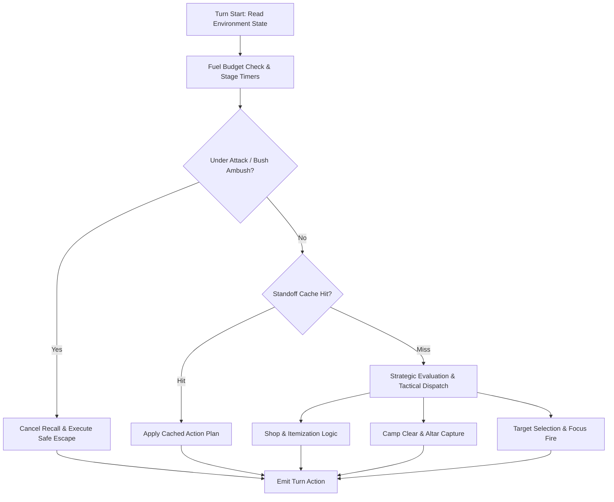

# Cambridge Battlecode 2026a — Bot Architecture

This document describes the high-level and component architecture of the bot engine powering the **Agentic Loop Builders** team (Team ID: `6b04505b-d16c-4196-b7c6-53a4688a32ca`) in Cambridge Battlecode 2026a. The production bot is implemented in C++ compiled to WebAssembly (WASM) and executed via the Cambridge Battlecode turnhost environment.

---

## 1. System Overview

In Cambridge Battlecode 2026a, each team controls 5 champions on a grid-based arena with dynamic fog of war, jungle camps, gem altars, monoliths, and recall mechanics. Each turn is strictly bounded by a **100,000 fuel limit**. Exceeding this budget causes turn abortion or forfeit.



---

## 2. Core Modules

The bot architecture is organized into modular header files located in `workspace/bots/ar-v121/src/` (and its lineage versions):

| Module | File | Purpose |
| :--- | :--- | :--- |
| **Main Cycle** | `v1_cycle.h` | Game lifecycle, round initialization, state tracking, turn sequencing |
| **Tactical Engine** | `v1_tactical.h` | Micro-combat simulations, focus-fire scoring, distance & range calculations |
| **Dispatch System** | `v1_dispatch.h` | Role assignment (tank, bruiser, carry), lane allocation, group regrouping |
| **Response Planner** | `v60_response.h` | Threat response, escape paths, pathfinding heuristics, fight evaluation |
| **Bot Entry Point** | `bot.cpp` | API hooks (`start()`, `act()`, `end()`), safety guards, recall defense |

---

## 3. Fuel Budgeting & Standoff Memoization

### The Standoff Freeze Problem
In earlier iterations (e.g. `v62` through `v97`), when 3 or more enemies entered vision simultaneously, the tactical evaluation engine would enumerate exponential move-and-cast combinations. This consumed 55,000–75,000 fuel on tactical planning alone, leaving the bot unable to run route searches (`route` requires $\ge 36,000$ fuel), leading to `fuelExhausted` timeouts and frozen champions standing still while under fire.

### Memoized Fight Evaluation
To solve this, `v62n` introduced **standoff memoization**:
1. When contact occurs, the state tuple $(P_{ally}, P_{enemy}, HP, CD, Shields, Bags, Round_{parity})$ is hashed.
2. If the tactical evaluation inputs have not changed from the prior turn and no damage was taken, the tactical plan is reused.
3. This saves over 40,000 fuel per turn in contested stalemates, allowing farming, repositioning, and objective captures to continue uninhibited.

---

## 4. Combat & Micro-Tactics

### Dynamic Outmatched Escape (`share < 0.35`)
In high-level play (1870–1960 rating), fight outcomes determine match winners (winners average 5.4 deaths vs losers 11.8 deaths). When analyzing match autopsies, 59% of deaths occurred when an isolated champion fought despite an overwhelming local enemy numerical superiority.
- The combat engine calculates the local **force share**:
  $$\text{share} = \frac{\sum HP_{allies}}{\sum HP_{allies} + \sum HP_{enemies}}$$
- If $\text{share} < 0.35$ and an enemy is within 5 tiles:
  - Tactical fight enumeration is bypassed.
  - The champion invokes `escapeHome()` or retreats toward the nearest healthy ally.
  - Legacy melee engagement fallbacks are prohibited.

### Bush Ambush & Recall Interruption Protection (v181 Breakthrough)
On maps with narrow brush choke-points (such as `00lanes`), enemy units concealed in fog-of-war bushes can attack champions channeling recall. Under legacy code, because the attacker was unseen on the vision map, the bot believed it was safe and repeatedly restarted its 5-turn recall channel until eliminated (resulting in 15+ deaths per match).
- **Damage Delta Detection**:
  ```cpp
  if (own.health < lastLowHp - 0.5f || recentRecallInterrupted) {
      // Direct damage taken without visual enemy identification
      isRecalling = false;
      escapeHome(own);
      return;
  }
  ```
- This ensures immediate defensive mobility, pathing to safety under friendly turret fire or altar protection rather than standing still.

---

## 5. Economic & Itemization Strategy

### 84-Slot Backpack Architecture (Engine 2.0.0 Compliance)
With Engine 2.0.0, the item inventory expanded from 42 to 84 slots, introducing 7 new emblem families:
- Old bots allocating fixed `unsigned items[42]` suffered catastrophic memory corruption and WASM trap crashes.
- All item buffers are strictly sized to 84 `uint32_t` slots with bounds-checked accessors.

### Melee Durability Rush vs Ranged Monster Scaling
In `shop()`, champions execute differentiated item build paths based on role:
- **Melee Frontline & Bruisers** (`Heart of Ruin`, `Ryth`, `Vendetta`):
  - Prioritize **Durability (Item ID 2)** and **Bruiser Health (Item ID 6)** early.
  - Avoid stalling on `Monster Shard (0)`, allowing melee champions to sustain camp clearing without dropping to lethal health thresholds by round ~300.
- **Ranged Carries** (`Vesper Vale`, `Marcella`, `Willow`):
  - Retain `Monster Shard` rush for rapid early jungle farming.
  - Scale into **Capture Emblem** and **Tribute Augments** for mid-to-late game area denial.

---

## 6. Draft Strategy

The drafting engine evaluates map topology, corridor density, and monster distributions:
1. **Corridor / Choke Maps**: Prefers `Cassi & Issac` + `Ryth` for zone control, high burst farming, and displacement.
2. **Open / Resource Maps**: Deploys `Heart of Ruin` + `Vesper Vale` + `Marcella` + `Tavi` / `Vendetta`.
3. **Draft ID Encoding Guard**: Distinguishes strictly between `champion_draft` and `champion_type` enums to prevent hero ID shift errors (such as misinterpreting Heart as Tavi or Marcella as Prism).
