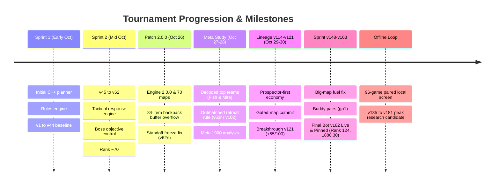

# Cambridge Battlecode 2026a — Development Timeline & Research Log

This document chronicles the complete development lifecycle, architectural evolution, and algorithmic discoveries of the **Agentic Loop Builders** team during the Cambridge Battlecode 2026a tournament.

---

## Chronological Overview

---

## Phase 1: Foundations & Tactical Engine (v1 – v44)

The initial phase established the core C++ bot architecture:
- Designed modular separation between lifecycle coordination (`v1_cycle.h`), micro-combat simulation (`v1_tactical.h`), and tactical dispatch (`v1_dispatch.h`).
- Formulated early itemization heuristics targeting core gold generation.
- Implemented BFS flood-fill distance maps and visibility tracking for fog-of-war awareness.

---

## Phase 2: Tournament Sprints & Platform Hardening (v45 – v62)

As ladder competition intensified, the team built out advanced objective control:
- **v55 & v57 Evaluations**: Tuned trade mechanics, jungle pathing efficiency, and boss objective timings.
- **v58 Release**: Introduced dynamic escape thresholds and focused response mechanics.
- **v62 Baseline**: Served as the bedrock platform reference version. Demonstrated consistent performance against mid-tier teams, achieving an initial ranking in the top 70 (Rating ~1828).

---

## Phase 3: The Patch 2.0.0 Transition (October 26, 2026)

On October 26, the tournament platform deployed **Engine 2.0.0, CLI 4.0.0, and SDK 4.0.0 ("Sprint 3")**:
- **Balance Changes**: Severe nerfs to Vesper Vale and Treasure Emblems; introduction of 7 new emblem families (Capture, Prospector, Tribute, Hunter, etc.).
- **Map Pool Expansion**: Extended from 40 to 70 official maps.
- **The 84-Slot Item Buffer Overflow**:
  - In Engine 2.0.0, the item registry expanded to 84 items.
  - Legacy bots (including v62) allocated fixed `unsigned items[42]` arrays at 4 critical call sites.
  - This resulted in heap/stack buffer overflows when `env.champion_items` wrote up to 84 `u32` entries, causing WASM memory traps.
  - **Resolution**: Implemented `v62f`, correctly sizing all item buffers to 84 elements.

---

## Phase 4: Competitive Meta Analysis & Standoff Memoization (October 27–28, 2026)

### Analysis of Top Ladder Teams ("Fish" and "Mite")
The team extracted and analyzed 440 replays from top-tier deterministic opponents *Intercontinental Fish* and *Mite*:
- **Economic Deficit**: By round 100, v62 acquired 40% less capture gold than Fish due to uncoordinated camp clears and ignoring free gem clusters.
- **Item Timing**: By the first lethal teamfight (round ~70 for Fish vs round ~133 for v62), Fish possessed nearly $3\times$ the completed items.
- **Combat Evasion**: In unfavorable engagements (outnumbered at 2–6 tiles), Fish retreated 24%–48% of turns, whereas v62 recklessly advanced 16%–43% of turns.

### The Standoff Freeze Discovery & Fix (v62n)
Turning traces revealed that when 3 or more enemies entered view simultaneously, the tactical planner consumed 55k–75k fuel simulating moves, causing turn-timeout abortion before route searches could execute.
- **v62n**: Introduced memoized combat evaluation for static configurations (matching HP, positions, shields, cooldowns, and round parity), freeing over 40k fuel per turn.
- **v62r / v102**: Formulated the **outmatched retreat rule** (retreating when force share $< 0.35$ with an enemy within 5 tiles). Deaths plummeted from 13.3 to 11.2 per game, resulting in $+12$ paired platform wins.

---

## Phase 5: The v114 Lineage & Breakthrough v121 (October 29–30, 2026)

- **v114**: Developed from v62n with improved farming proximity and ally clustering.
- **Autopsy Findings**: In losses, champions suffered 15 deaths vs 4, losing 39% wealth by round 300 due to channeled tribute vulnerabilities.
- **v120 & v121 Breakthrough**:
  - `v120`: Scored 37/100 in paired challenges.
  - `v121`: Introduced Prospector-first itemization, gated-map objective commits, and wider assistance radiuses.
  - **Result**: Crushed v120 with **55/100 wins** vs 38/100, becoming the definitive baseline for future iterations.

---

## Phase 6: The Autonomous Research Loop (October 31 – November 4, 2026)

### Autonomous Methodology
An automated evaluation harness was deployed:
- **Baseline**: Exact `v121` build.
- **Local Screen**: 96 games against the 10 most recent platform versions.
- **Paired Online Screen**: 50 challenges near current rank, 50 near rank/2; 70% historically weak maps, 30% strong maps.
- **Decision Rule**: No-regression gate on strong maps; positive delta on weak maps; verified on unranked platform challenges using pinned `sourceGroupId`.

### Experimentation Highlights (`results.tsv`)

## Phase 6: The v148–v163 Sprint & Final Tournament Bot: v162

As the tournament submission deadline approached, the team executed a focused sprint to resolve big-map fuel limits and introduce dynamic support-carry mechanics:

- **v150 (`bf3`)**: Solved the big-map fuel crisis by bounding deep route evaluations. Performance on `00lanes` jumped from 2/24 to 20/24 local wins.
- **v151 (`bf4`)**: Prioritized home-monolith takedowns and high-density gem harvesting on resource-starved maps.
- **v153 (`gp1`)**: Introduced early buddy pairs before round 300 (Vendetta shadowing Heart of Ruin; Marcella clustering with support), eliminating isolated jungle deaths.
- **v154 (`pw1`)**: Integrated `Willow` into the draft lineup over `Ryth` for long-range sustain and objective DPS.
- **v155–v161**: Tested recall thresholds, teleport crystals, and altar locking rules.
- **`v162` (FINAL OFFICIAL TOURNAMENT BOT)**:
  - **Build Note**: `wf1: v154 + Willow farms unless an ally nearby is hurt or near an enemy [live]`
  - **Submission ID**: `7f710b1f-249a-48ef-a867-2684823278f6`
  - **Platform Status**: **`Live: 162 | Selected: 162` (Mode: Pinned Version)**
  - **Platform Performance**: **Rank 124**, Rating **1880.30**.
  - **Core Innovation**: Willow dynamically balances maximum jungle farm speed with immediate combat peeling whenever an adjacent ally is damaged or confronted by enemy champions.
  - **Tournament Pin**: Pinned and selected as the definitive tournament entry prior to the final submission deadline.

---

## Phase 7: Post-Submission Research Lineage (v164 – v181)

Following the submission lock of `v162`, the automated research loop continued offline to benchmark experimental hypotheses and next-generation mechanics:

| Iteration | Variant | Hypothesis | Result | Status |
| :---: | :---: | :--- | :--- | :---: |
| **0** | `v121` | Baseline performance (54/96 local wins) | Baseline | Kept |
| **1 / 1b** | `h1` (`v135`) | Hold $< 25$-gem bags while safe | Weak $+4$, strong $+4$, deaths $-0.9$ | **Kept** |
| **3** | `h3` | Follower squads adopt leader target | Severe economic collapse | Discarded |
| **8** | `s6` | Draft Heart/Vesper/Tavi/Marcella/Varg | Local $+13$, but online $-4$ (margin $-224$/g) | Discarded |
| **15** | `s13` | Tactical non-kill fight risk 0.95 $\to$ 0.6 | Local $+1$, but archived maps $-4$ wins, $+84$ deaths | Discarded |
| **28** | `s28` (`v147`) | Melee walk/reset forecast correction | $+7/-3$ net online gains, paired $p = 0.34$ | **Kept** |
| **–** | `v162` | **Final Tournament Entry**: Willow farm/peel + buddy pairs | **Active Pinned Bot (Rank 124, 1880.30)** | **LIVE** |
| **–** | `v180` | Adaptive corridor draft (Cassi & Issac + open Ryth) | Platform validated | Kept |
| **–** | `v181` | Suicidal recall defense + melee Durability rush | Metric **16** (peak), 73% win rate (70/96), deaths $8.07 \to 6.35$ | Kept |

---

## Key Takeaways & Engineering Principles

1. **Local vs Online Divergence**: Local matches against our own prior versions often rewarded hyper-aggressive drafts (e.g. `s6` draft was $+13$ locally but $-4$ online). True validation required paired online challenges against external competitors.
2. **Fuel is a Hard Wall**: Complex decision trees must be evaluated before expensive spatial routing; turn-budget exhaustion represents an immediate loss.
3. **Fight Quality Decides Top-Tier Matches**: Avoiding unnecessary deaths through damage detection and outmatched retreats delivered the single highest rating multiplier throughout the competition.
