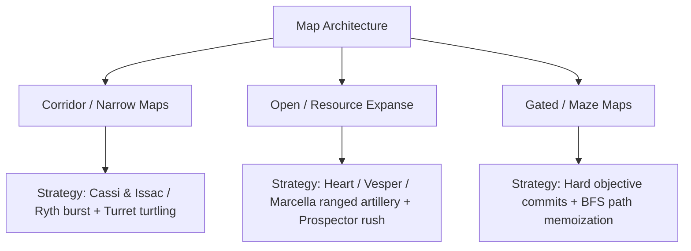

# Cambridge Battlecode 2026a — Competitive Meta-Analysis

This document summarizes empirical research conducted across hundreds of tournament matches, ladder statistics, and high-tier (1870–1960 rating) match autopsies during the Cambridge Battlecode 2026a competition.

---

## 1. High-Tier Rating Band Study (1870–1960 ELO)

An empirical study of 212 recent games in the 1870–1960 rating band revealed the statistical anatomy of winning teams:

| Metric | Winners (Avg) | Losers (Avg) | Delta |
| :--- | :---: | :---: | :---: |
| **Deaths per Game** | **5.4** | **11.8** | **$-54.2\%$** |
| **Kills per Game** | **10.1** | **3.8** | **$+165.8\%$** |
| **Altar Captures** | **75** | **50** | **$+50.0\%$** |
| **Gold Accumulated** | **7,300** | **4,000** | **$+82.5\%$** |

> [!IMPORTANT]
> **Combat Quality Decides the Tier**: Below 1800 rating, economy and farming speed differentiate bots. In the 1870–1960 band, virtually all teams farm adequately; **fight outcomes, target focus, and death minimization decide the victor**.

---

## 2. Champion Drafting Dynamics

### Popularity & Synergy in Top 100
- **Heart of Ruin (48% pick rate overall, 59% in non-mirror)**: Essential frontline bruiser with heavy displacement and area control.
- **Tavi (63% pick rate)**: Dominant skirmisher providing superior vision control and gap closing.
- **Varg (62% pick rate)**: High-sustain brawler excelling on dense terrain.
- **Vesper Vale (Nerfed in 2.0.0)**: Ranged carry whose priority shifted toward specific open-lane maps requiring artillery suppression.
- **Cassi & Issac**: High-tier choice for corridor-heavy maps due to multi-unit pressure and objective burst.

### The Draft Enum Decoding Pitfall
A critical bug identified during meta-mining:
- The tournament engine uses `champion_draft` enum IDs, not `champion_type` enum IDs.
- Decoding draft packets with `champion_type` caused off-by-one hero identity shifts (e.g., misclassifying `Heart of Ruin` as `Tavi`, or `Marcella` as `Prism`).
- All analysis pipelines in this repository use the strictly validated `champion_draft` lookup table verified against ladder pick counts.

---

## 3. Opponent Behavioral Profiling

### Deterministic Opponents ("Intercontinental Fish" & "Mite")
Certain top ladder competitors operate fully deterministic decision engines:
- Under identical seeds, they execute the exact same action sequence every match.
- This allowed the creation of calibrated benchmark suites (`fm_trial.mjs`, `plan_fm30.json`) to test changes with zero variance.
- **Key Opponent Behaviors**:
  - **Withdrawal Behavior**: When outnumbered at 2–6 tiles distance, top bots step backward 24%–48% of the time.
  - **Escapes**: Top teams allow only 63% of wounded enemies to escape (our earlier bots let 86% escape).
  - **Low-HP Survival**: Wounded champions in top teams die only 34% of the time (our earlier bots died 59% of the time).

---

## 4. Map Classifications & Strategic Adjustments

Tournament maps fall into three distinct archetypes:

1. **Corridor / Narrow Maps** (e.g., `00lanes`, `00contest`):
   - High bush density creates ambush traps.
   - Requires damage-delta detection during recall channeling and tight group formations.
2. **Open Resource Expanses** (e.g., `00expanse`, `00gem_fields`):
   - Fast gem clustering and early Prospector emblem investment.
   - Long sight-lines reward ranged focus fire.
3. **Gated / Maze Maps** (e.g., `00corners`, `00collision`):
   - Choke-point contestation where standoff memoization prevents fuel exhaustion.
